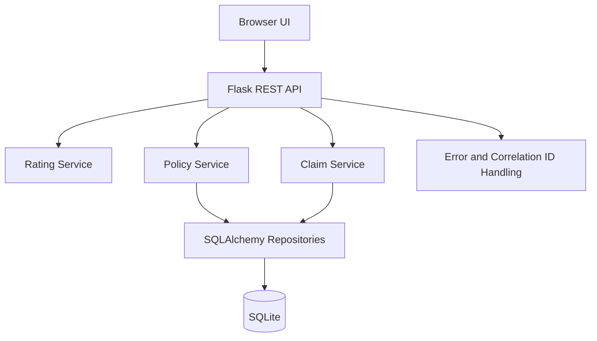

# Auto Insurance Quote & FNOL Claim App — Build Plan

## Scope and source of truth
This scaffold implements the approved MVP in `Architect-dynamic-agent/TSD.md`: deterministic `rating-v1` quotes, policy binding, basic FNOL submission, and read-only claim lookup. The authoritative assumptions are minimum age 18, supported vehicle types `sedan`, `suv`, `truck`, `motorcycle`, USD, inclusive coverage dates, and statuses `ACTIVE`, `EXPIRED`, `CANCELLED`, and `FNOL_SUBMITTED`.

## Stack and rationale
- **Python 3.12 + Flask 3.x:** matches the TSD's lightweight modular-monolith decision and serves both JSON REST endpoints and the self-contained browser UI.
- **SQLAlchemy 2.x + SQLite:** provides typed repository boundaries, referential integrity, WAL configuration, and zero external runtime dependencies for local MVP use.
- **Vanilla HTML/CSS/JavaScript:** keeps the UI self-contained and avoids a frontend build pipeline.
- **pytest:** supports direct pure-function rating tests and isolated API/database validation tests.
- **Gunicorn-ready WSGI entrypoint:** local Flask remains convenient, while deployment can later use a production WSGI server.

## Module breakdown
- `app/config.py`: environment-driven settings, database URL, request size, and secret configuration.
- `app/extensions.py`: SQLAlchemy instance and application extension setup.
- `app/models.py`: `Policy` and `Claim` persistence models plus status constants.
- `app/rating.py`: pure `rating-v1` calculation and domain validation errors.
- `app/repositories.py`: policy/claim persistence interfaces and SQLAlchemy implementations.
- `app/services.py`: quote, policy-binding, FNOL, and claim-status use cases; authoritative validation lives here.
- `app/api.py`: versioned JSON routes, error mapping, correlation IDs, and health endpoint.
- `app/__init__.py`: Flask app factory, SQLite pragmas, schema initialization, and static/template wiring.
- `app/templates` and `app/static`: browser forms for quote, bind, FNOL, and claim lookup.
- `tests/`: mirrored test skeleton, fixtures, three rating examples, and two required claim validation checks.

## Target tree
```text
auto-insurance-app/
  app/
    __init__.py                 # Flask app factory and database initialization
    config.py                   # Environment-backed settings
    extensions.py               # SQLAlchemy extension
    models.py                   # Policy and Claim ORM models
    rating.py                   # Pure rating-v1 domain service
    repositories.py             # Repository contracts and SQLAlchemy implementations
    services.py                  # Quote, policy, FNOL, and status use cases
    api.py                      # /api/v1 routes and safe error responses
    templates/
      index.html                # Self-contained UI shell
    static/
      app.js                    # Browser API orchestration and safe rendering
      styles.css                # Minimal accessible styling
  tests/
    conftest.py                 # Isolated SQLite app/client fixtures
    test_rating.py              # Three required premium unit checks
    test_validation.py          # Out-of-coverage and inactive-policy checks
    test_api.py                 # Smoke/status endpoint skeleton
  run.py                        # WSGI entrypoint
  requirements.txt              # Runtime and test dependencies
  pyproject.toml                # Tooling and pytest configuration
  Dockerfile                    # Container image for WSGI execution
  .env.example                  # Safe local configuration template
  .gitignore                    # Local artifacts and secrets exclusions
  README.md                     # Setup, run, test, and MVP limits
```

## Dependency diagram


## Build order
1. **Foundation:** configuration, extension setup, app factory, database pragmas, and model schema.
2. **Domain:** rating constants/validation and typed domain exceptions; keep rating side-effect free.
3. **Persistence:** repository contracts and SQLAlchemy implementations with transaction boundaries.
4. **Use cases:** quote, policy bind with server-side recalculation, FNOL eligibility/date checks, and status lookup.
5. **HTTP/UI:** versioned routes, stable error contract, correlation IDs, safe frontend rendering, and health check.
6. **Verification:** direct rating tests, API validation tests asserting no invalid writes, and endpoint smoke tests.
7. **Packaging:** local instructions, Docker/Gunicorn path, and explicit SQLite/authentication production limitations.

## Key risks and open questions
- The approved demonstration rating schedule must be replaced only through reviewed, versioned configuration for real insurance use.
- SQLite is intentionally local-only; migrate to PostgreSQL before multi-user concurrency or production retention requirements.
- No authentication is included in this MVP; keep the default bind address on localhost until authorization is added.
- Jurisdiction-specific age, dates, retention, and claims rules require product/legal approval.
- Free-text descriptions may contain sensitive data; logs must not include raw request bodies or descriptions.

## Definition of scaffold completion
The saved tree is importable, exposes the four API journeys, creates SQLite schema on startup, and contains the required test targets. Business implementation points are marked with focused TODOs rather than hidden in the UI.

### Tree amendment
The scaffold also includes `.github/workflows/ci.yml`, a minimal CI test workflow. This operational file belongs at the project root alongside the tree above and runs the pinned pytest suite on pushes and pull requests.
