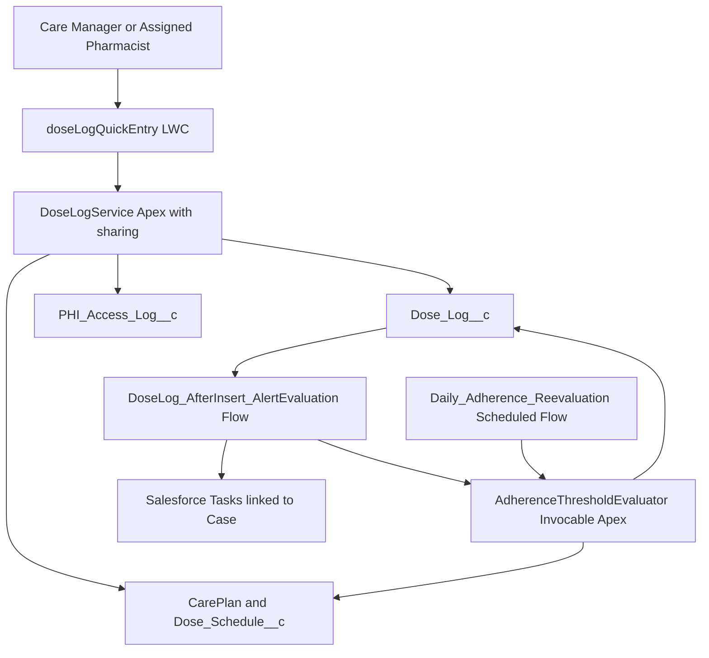

# Build Plan — Missed Dose Logging & Adherence Alerts

## Scope and source

This scaffold is derived from the authoritative Salesforce Health Cloud TSD (`Architect-dynamic-agent/TSD.md`) and the intake meeting note. It covers Phase 1 structured missed-dose capture, patient-scoped adherence calculation, Flow-based alerting, PHI audit integration, and the daily 06:30 Asia/Kolkata re-evaluation. Patient outreach, dispense reconciliation, hospitalization pause logic, cross-widget signals, and supervisor-override UX remain out of scope.

## Chosen stack and rationale

- **Platform:** Salesforce Health Cloud, deployed as Salesforce DX metadata. This preserves PHI inside the existing security boundary and uses the Care Plan Lightning Record Page as the primary work surface.
- **UI:** Lightning Web Components, specifically `doseLogQuickEntry`, for single-click launch, keyboard-first entry, record-page placement, and fast refresh.
- **Service layer:** Apex `with sharing`, DTOs, selectors, and service classes. Apex is authoritative for authorization, CRUD/FLS, date/Notes validation, transaction handling, adherence calculations, and audit writes.
- **Automation:** Record-triggered and scheduled Salesforce Flow for threshold orchestration, Task routing, deduplication, comments, and operational fault paths. Invocable Apex performs calculation; Flow owns visible routing decisions.
- **Storage:** Existing `Dose_Log__c`, `Dose_Schedule__c`, `CarePlan`, `Case`, `Task`, and `PHI_Access_Log__c` objects. Exact field API names are intentionally isolated in selectors/configuration until org schema confirmation.
- **Testing:** Apex tests, LWC Jest tests, and Flow metadata with a mirrored test skeleton. CI uses Salesforce CLI validation and test execution.
- **Deployment:** Salesforce DX source format with `sfdx-project.json`, package directories, permission set, page component metadata, and GitHub Actions validation.

## Module/service breakdown

| TSD component | Scaffold module | Responsibility |
|---|---|---|
| `doseLogQuickEntry` | `force-app/main/default/lwc/doseLogQuickEntry` | Form state, client validation, context display, submission and refresh wiring. |
| `DoseLogService` | `classes/DoseLogService.cls` | Public Apex contract: context, create, adherence, and update operations. |
| DTOs | `DoseLogDtos.cls` | Typed request/response wrappers crossing the LWC/Apex boundary. |
| Data access | `DoseLogSelector.cls`, `DoseScheduleSelector.cls` | Bounded, relationship-scoped queries; exact org fields are centralized here. |
| Adherence algorithm | `AdherenceCalculator.cls` | 30/60/90-day windows, denominator handling, duplicate warnings, and consecutive sequence contract. |
| Alert calculation | `AdherenceThresholdEvaluator.cls` | Invocable/Flow-facing breach evaluation and severity ordering; no Task DML. |
| PHI audit | `PhiAuditWriter.cls` | Adapter around the approved existing `PHI_Access_Log__c` helper/Event pattern. |
| Event automation | `DoseLog_AfterInsert_AlertEvaluation.flow-meta.xml` | Invokes evaluator and routes/de-duplicates Tasks through Flow. |
| Daily automation | `Daily_Adherence_Reevaluation.flow-meta.xml` | 06:30 Asia/Kolkata candidate processing and retry/fault path placeholder. |
| Security/config | `DoseLogPermissionSet.permissionset-meta.xml`, custom metadata placeholder | Least-privilege access and configurable thresholds/wording. |

## Target folder structure

```text
force-app/main/default/
  classes/
    AdherenceCalculator.cls                 # Rolling adherence and sequence calculation contract
    AdherenceCalculator.cls-meta.xml
    AdherenceThresholdEvaluator.cls        # Flow-invocable threshold evaluation
    AdherenceThresholdEvaluator.cls-meta.xml
    DoseLogDtos.cls                         # Serializable request/response DTOs
    DoseLogDtos.cls-meta.xml
    DoseLogSelector.cls                     # Bounded Dose_Log__c selector
    DoseLogSelector.cls-meta.xml
    DoseLogService.cls                      # Main with-sharing application service
    DoseLogService.cls-meta.xml
    DoseScheduleSelector.cls                # Care Plan schedule selector
    DoseScheduleSelector.cls-meta.xml
    PhiAuditWriter.cls                      # PHI audit adapter
    PhiAuditWriter.cls-meta.xml
  flows/
    DoseLog_AfterInsert_AlertEvaluation.flow-meta.xml  # Post-insert threshold orchestration
    Daily_Adherence_Reevaluation.flow-meta.xml         # Daily targeted re-evaluation
  lwc/doseLogQuickEntry/
    doseLogQuickEntry.html                   # Accessible quick-entry layout
    doseLogQuickEntry.js                     # UI state and Apex calls
    doseLogQuickEntry.js-meta.xml            # Care Plan record-page exposure
  permissionsets/
    DoseLogPermissionSet.permissionset-meta.xml        # Feature access contract
  layouts/
    Dose_Log__c-Dose Log Layout.layout-meta.xml        # Admin layout placeholder
  objects/Dose_Log__c/
    fields/.gitkeep                          # Schema additions pending org confirmation
  package.xml                                # Metadata deployment manifest
config/project-scratch-def.json              # Scratch org baseline
scripts/apex/seed-dose-log-config.apex      # Non-PHI development setup placeholder
force-app/main/default/classes/tests/
  AdherenceCalculatorTest.cls                # Calculator unit test skeleton
  AdherenceCalculatorTest.cls-meta.xml
  DoseLogServiceTest.cls                    # Service/security boundary test skeleton
  DoseLogServiceTest.cls-meta.xml
  AdherenceThresholdEvaluatorTest.cls       # Threshold precedence test skeleton
  AdherenceThresholdEvaluatorTest.cls-meta.xml
tests/lwc/doseLogQuickEntry/
  doseLogQuickEntry.test.js                  # Jest test skeleton
.github/workflows/validate.yml               # Salesforce CLI validation stub
sfdx-project.json                            # Salesforce DX project config
README.md                                     # Setup, deployment, and implementation notes
.env.example                                  # Non-secret local variables
Dockerfile                                    # Optional Salesforce CLI container
```

## Build order and milestones

1. **Schema and compliance confirmation (3 days):** Confirm API names/relationships for `Dose_Log__c` and `Dose_Schedule__c`, the approved `PHI_Access_Log__c` write mechanism, Task recipient relationships, and final Reason values.
2. **Metadata foundation (4 days):** Add/confirm fields, permission set, object layout, Care Plan page placement, and threshold/custom metadata. Do not enable the feature broadly yet.
3. **Apex data and service layer (7 days):** Implement selectors, DTOs, server-side validation, CRUD/FLS checks, audit transaction boundary, bounded adherence calculation, update window, and unit tests.
4. **LWC experience (5 days):** Implement default/populated/back-date/error states, accessibility, submit lock, non-PHI error handling, and Jest tests.
5. **Flow automation (5 days):** Implement after-insert evaluator invocation, severity selection, 24-hour/open-task suppression, comments, recipient routing, scheduled Flow, and fault paths.
6. **Integration and hardening (5 days):** Validate LWC/Apex/Flow contracts, query selectivity, governor limits, audit completeness, load behavior, and security personas.
7. **UAT and release (7 days):** Validate with six care managers, evidence the under-15-second goal, pilot through permission-set assignment, deploy through the Benefit Summary release train, and retain a time-boxed legacy fallback.

## Key risks and open questions

- Exact Salesforce API names and relationship cardinality are not supplied; selectors isolate this uncertainty and must be completed before implementation.
- Schedule recurrence/occurrence semantics must be confirmed, especially for non-daily medication schedules and `CONSEC-3`.
- The approved synchronous audit helper or Platform Event pattern is unresolved; `PhiAuditWriter` is an explicit adapter seam.
- Recipient identity for Dr. Kunal Bhatt and primary care managers, Task Case association, wording, and due-date policy need org confirmation.
- Flow governor limits and race behavior around duplicate suppression require production-like volume testing.
- Zero-denominator behavior, strict threshold boundaries, duplicate dose occurrences, and edit effects must be approved as contract tests.

## Dependency diagram




The diagram renderer was unavailable in the execution environment; the source remains included for repository rendering.
