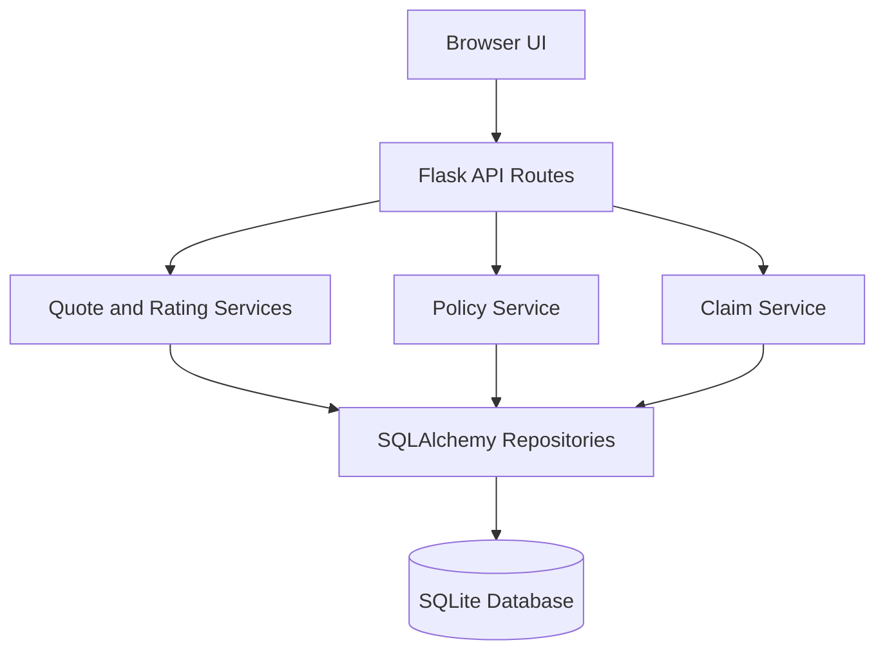

# Auto Insurance Quote & FNOL App — Build Plan

## 1. Stack and rationale

- **Python 3.12 + Flask 3.x**: matches the approved TSD and keeps the modular monolith lightweight.
- **SQLAlchemy 2.x + SQLite**: relational integrity, foreign keys, unique quote binding, and zero external services for local use.
- **Server-rendered HTML + progressive JavaScript**: one self-contained browser experience; browser never owns authoritative rating or coverage rules.
- **pytest**: isolated unit/service and API tests, including the three required rating cases and two coverage-validation cases.

Initial business assumptions are rating version `v1`, USD cents with half-up rounding, supported vehicles `sedan`, `suv`, `sports`, minimum eligible age 18, inclusive coverage dates, active policy status `ACTIVE`, and submitted claim status `SUBMITTED`. These require business approval before production.

## 2. Module breakdown

- `app/config.py`: environment-driven database, host, port, and debug settings.
- `app/models.py`: Quote, Policy, and Claim SQLAlchemy entities and lifecycle constants.
- `app/repositories.py`: persistence boundary for quote, policy, and claim reads/writes.
- `app/services/rating.py`: deterministic age/vehicle rating and quote creation contract.
- `app/services/policy.py`: eligible-quote binding, date validation, and policy lookup.
- `app/services/claim.py`: FNOL validation, inclusive coverage check, claim creation, and status lookup.
- `app/api/routes.py`: JSON REST endpoints under `/api/v1`; maps domain failures to stable error responses.
- `app/web/routes.py` and templates/static assets: thin UI shell and progressive API client.

## 3. Target folder structure

```text
project/
  app/
    __init__.py              # Flask factory, database setup, route registration
    config.py                # environment configuration
    db.py                    # SQLAlchemy engine/session helpers
    models.py                # Quote, Policy, Claim ORM models
    repositories.py          # persistence interfaces and SQLite implementation
    errors.py                # domain exceptions and HTTP mapping data
    services/
      __init__.py
      rating.py              # premium and quote service
      policy.py              # policy binding service
      claim.py               # FNOL and claim status service
    api/
      __init__.py
      routes.py              # REST API controllers
    web/
      __init__.py
      routes.py              # browser shell route
      templates/
        index.html            # self-contained UI
      static/
        app.js                # progressive API client
        styles.css             # minimal styling
  tests/
    conftest.py              # isolated temporary SQLite fixtures
    test_rating.py            # three premium rating tests
    test_claim_validation.py  # before-start and after-end/expired checks
    test_api.py                # API contract smoke tests
  run.py                      # local entrypoint
  requirements.txt            # pinned runtime/test dependencies
  pyproject.toml              # pytest and tool configuration
  Dockerfile                  # optional local container
  .env.example                # safe environment template
  .github/workflows/ci.yml    # CI stub
  README.md                   # setup and local run instructions
```

## 4. Dependency diagram



The Mermaid renderer was unavailable in this environment; the diagram uses standard `graph TD` syntax and matches the TSD dependency direction.

## 5. Build order and milestones

1. **Foundation** — configuration, SQLAlchemy session lifecycle, models, constraints, and factory.
2. **Rating/quotes** — centralize rates and eligibility; add pure rating tests and quote endpoint.
3. **Policy binding** — validate strict date ordering, enforce one policy per quote, add retrieval endpoint.
4. **FNOL/status** — validate policy status, inclusive loss coverage, report date, description, and claim persistence.
5. **UI and operational shell** — connect forms to REST endpoints; add health/readiness and safe local defaults.
6. **Verification** — run unit/API tests, verify no invalid writes, initialize an empty database, and review error contracts.

## 6. Risks and open questions

- Demonstration rates and minimum age are assumptions; obtain business approval before production.
- SQLite is single-process/local scope; migrate to PostgreSQL before horizontal scaling or public deployment.
- Authentication, authorization, privacy, backups, TLS, and regulatory controls are intentionally outside this local scaffold and are release gates for internet exposure.
- Duplicate FNOL idempotency, quote expiration, and claim status transitions require later product decisions.

## 7. Definition of scaffold completion

The scaffold is complete when a clean checkout can initialize SQLite, start Flask on loopback, expose quote/bind/FNOL/status flows, and run the five mandatory rule tests without external services. Business logic is represented by implementation-ready contracts and TODOs rather than production-complete underwriting or claims logic.
