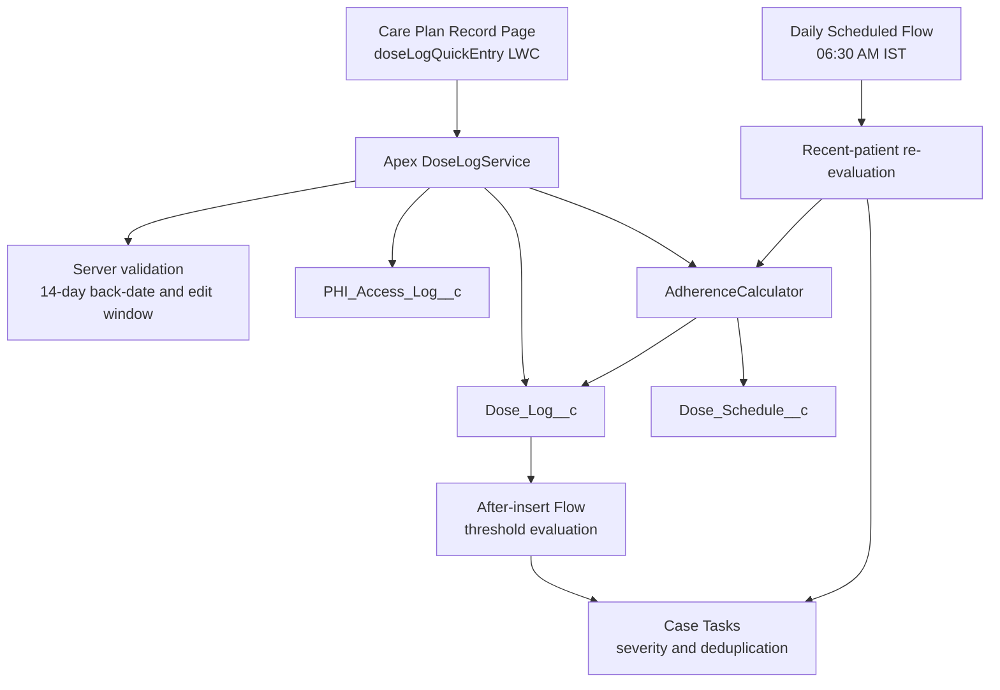

# Build Plan — Missed Dose Logging & Adherence Alerts

## 1. Scope and delivery boundary

This plan translates the 22 July 2026 discovery meeting into an implementation plan for **Phase 1** of CarePath Plus's missed-dose logging and adherence alerting capability.

### In scope

- Custom Salesforce LWC `doseLogQuickEntry` embedded on the Health Cloud Care Plan Lightning Record Page.
- Structured creation of `Dose_Log__c` records from a care manager or assigned pharmacist's workflow.
- Server-side validation, audit logging, and rolling 30-, 60-, and 90-day adherence calculation through Apex.
- Post-insert threshold evaluation and Task creation through a record-triggered Flow.
- Daily scheduled re-evaluation at 06:30 AM IST for patients with a `Dose_Log__c` entry in the previous 45 days.
- Task deduplication, severity precedence, and comments on existing open Tasks.
- Compliance controls for `PHI_Access_Log__c`, curated Reason values, back-dating, and edit windows.

### Explicitly out of scope

- Patient-facing SMS, portal, or other outreach.
- Pharmacy dispense reconciliation.
- Hospitalization-driven adherence pauses.
- Supervisor override UX; administrator/manual DML remains acceptable for Phase 1.
- Cross-widget adherence signals with Financial Assistance or Refill workstreams.

## 2. Chosen platform and rationale

| Concern | Choice | Rationale |
|---|---|---|
| Application platform | Salesforce Health Cloud | The meeting identifies Health Cloud Care Plans, Cases, Tasks, Flows, LWC, Apex, and custom objects as the target runtime. |
| User interface | Lightning Web Component (`doseLogQuickEntry`) | Supports a single-click, tab-order-friendly quick-entry surface directly on the Care Plan record page without navigation. |
| Server layer | Apex service class | Centralizes insert validation, audit-log writing, edit authorization, and adherence calculation; server enforcement prevents UI bypass. |
| Persistence | Existing/custom Salesforce objects: `Dose_Log__c`, `Dose_Schedule__c`, `PHI_Access_Log__c` | Reuses the existing care-plan dose schedule and established PHI audit trail. Schema confirmation is an open dependency. |
| Alert orchestration | Salesforce Record-Triggered Flow | The agreed design supports Get Records + Decision logic for open-task lookup and threshold severity handling without an Apex trigger. |
| Scheduled processing | Salesforce Scheduled-Triggered Flow | Runs daily at 06:30 AM IST and re-evaluates the recent activity cohort rather than recalculating all approximately 4,200 active patients. |
| Testing | Salesforce Apex tests, LWC Jest tests, Flow/UAT validation | Covers server contracts, UI interaction, Flow rules, access controls, and the six-care-manager-per-hub UAT cohort. |
| Delivery | Salesforce DX source format, scratch/sandbox deployment pipeline | Enables versioned metadata, repeatable validation, and alignment with the Benefit Summary widget release train. |

## 3. Component and module breakdown

### 3.1 `doseLogQuickEntry` LWC

- Expose the current Care Plan record ID and derive the active medication from the Care Plan.
- Default Dose Date/Time to now; permit back-dating only within the previous 14 days.
- Present the curated Reason values: `Forgot`, `Side effects`, `Cost / access`, `Feeling better`, `Travel`, `Hospitalization`, and `Other` (subject to clinical confirmation).
- Accept optional Notes with a 500-character maximum and an explicit PHI-scrub warning.
- Provide loading, success, validation-error, server-error, and back-date error states.
- Use accessible labels, keyboard/tab ordering, and a single-click open action.
- Render 30-, 60-, and 90-day adherence values by calling the Apex service on widget load.

### 3.2 Apex service and domain contracts

- `DoseLogService`: public methods for creating a log, retrieving widget data, and enforcing edit behavior.
- `DoseLogValidator`: validates active medication association, required fields, date range, Notes length, and edit-window rules.
- `AdherenceCalculator`: calculates `(scheduled doses - missed doses) / scheduled doses * 100` for 30-, 60-, and 90-day rolling windows using `Dose_Schedule__c` and `Dose_Log__c`.
- `PhiAuditLogWriter`: writes user ID, patient ID, timestamp, and `DOSE_LOG_ENTRY` to the established `PHI_Access_Log__c` pattern.
- `DoseLogSelector` / query boundary: isolates SOQL and supports selective queries for the patient and rolling windows.
- Enforce sharing, CRUD, and field-level security according to the org's established security model.

### 3.3 Record-triggered alert Flow

Trigger after `Dose_Log__c` insertion. Evaluate thresholds in severity order:

1. 30-day adherence below 60%: High priority Task for Dr. Kunal / clinical pharmacist and a copy for the primary care manager.
2. Three or more consecutive missed doses in seven days: High priority Task for the primary care manager.
3. 30-day adherence below 80%: Normal priority Task for the primary care manager.

Apply these controls:

- At most one adherence Task per patient per 24 hours, regardless of the number of breached thresholds.
- Highest-severity breach wins when multiple thresholds are breached together.
- If an open Task exists for the same patient and threshold type, do not create another; append a comment to the existing Task.
- Relate Tasks to the relevant Case and patient record, and assign the agreed owner.

### 3.4 Scheduled daily re-evaluation Flow

- Run at 06:30 AM IST.
- Find patients with at least one `Dose_Log__c` entry during the prior 45 days.
- Recalculate the 30-day rolling adherence and apply the same threshold and deduplication rules.
- Keep the scope selective to avoid a full-patient-base recalculation.
- Confirm Flow limits and query selectivity in a representative sandbox before UAT.

### 3.5 Salesforce metadata and configuration

- Confirm or add `Dose_Log__c` fields and relationships, including dose date/time, medication, reason, notes, Care Plan, patient, and audit-relevant relationships.
- Confirm the current `Dose_Schedule__c` schema and schedule semantics with the Salesforce Technical Lead.
- Configure the Reason picklist as a controlled value set; do not replace it with unrestricted free text.
- Configure custom metadata or equivalent constants for threshold values, lookback windows, owner routing, and deduplication intervals where practical.
- Place the LWC on the Care Plan Lightning Record Page and expose only the required user actions.

## 4. Proposed source and metadata tree

The following is the target Salesforce DX structure for the implementation. It is a planning tree only; this request intentionally produces `PLAN.md` and no source scaffold files.

```text
force-app/main/default/
  classes/
    DoseLogService.cls                         # Apex facade for create, read, and edit operations
    DoseLogService.cls-meta.xml                # Apex class metadata
    DoseLogValidator.cls                       # Server-side field, date, and authorization validation
    DoseLogValidator.cls-meta.xml              # Apex class metadata
    AdherenceCalculator.cls                    # Rolling-window adherence calculation contract
    AdherenceCalculator.cls-meta.xml           # Apex class metadata
    PhiAuditLogWriter.cls                      # PHI_Access_Log__c audit write boundary
    PhiAuditLogWriter.cls-meta.xml             # Apex class metadata
    DoseLogSelector.cls                        # Selective SOQL/query boundary
    DoseLogSelector.cls-meta.xml               # Apex class metadata
    DoseLogServiceTest.cls                     # Apex service and validation tests
    DoseLogServiceTest.cls-meta.xml            # Apex test metadata
    AdherenceCalculatorTest.cls                # Rolling-window calculation tests
    AdherenceCalculatorTest.cls-meta.xml       # Apex test metadata
  lwc/
    doseLogQuickEntry/
      doseLogQuickEntry.html                   # Accessible quick-entry and adherence display markup
      doseLogQuickEntry.js                     # UI state, Apex calls, validation, and events
      doseLogQuickEntry.js-meta.xml            # Care Plan record-page exposure
      doseLogQuickEntry.css                    # Scoped layout and state styling
      __tests__/
        doseLogQuickEntry.test.js              # Jest interaction and accessibility skeleton
  flows/
    Dose_Log_After_Insert_Alert_Evaluation.flow-meta.xml # Threshold and Task deduplication Flow
    Dose_Log_Daily_Adherence_Reevaluation.flow-meta.xml  # 06:30 IST scheduled Flow
  objects/
    Dose_Log__c/
      fields/                                  # Dose date/time, medication, reason, notes, relationships
      Dose_Log__c.object-meta.xml              # Object definition and sharing settings
    Dose_Schedule__c/
      Dose_Schedule__c.object-meta.xml         # Existing schedule schema reference/changes if required
    PHI_Access_Log__c/
      PHI_Access_Log__c.object-meta.xml        # Existing audit object reference
  flexipages/
    Care_Plan_Record_Page.flexipage-meta.xml   # Placement of doseLogQuickEntry on the Care Plan page
  permissionsets/
    CarePath_Adherence_Logger.permissionset-meta.xml # Least-privilege access for permitted users
  customMetadata/
    Adherence_Thresholds.*.md-meta.xml         # Optional configurable threshold and routing values
  labels/
    CustomLabels.labels-meta.xml               # User-facing validation and error messages
  flows/
    README.md                                  # Flow ownership, limits, and deployment notes
config/
  project-scratch-def.json                     # Salesforce DX scratch-org definition
  permission-set-assumptions.md                # Environment-specific access prerequisites
scripts/
  deploy-validate.sh                           # Validation-only deployment entrypoint
  deploy-release.sh                             # Controlled deployment entrypoint
force-app/main/default/lwc/
  README.md                                    # LWC development and Jest conventions
.github/workflows/
  validate.yml                                 # Salesforce metadata validation and test stub
README.md                                      # Project setup, deployment, and test instructions
sfdx-project.json                              # Salesforce DX project configuration
PLAN.md                                        # This implementation plan
```

## 5. Dependency diagram

The diagram renderer was unavailable in this environment, so the valid Mermaid source is retained below for rendering by the consuming documentation pipeline.



## 6. Build order and milestones

### Milestone 0 — Discovery closure and schema confirmation

1. Confirm `Dose_Log__c` and `Dose_Schedule__c` fields, relationships, data types, and schedule interpretation by 24 July.
2. Confirm whether PHI audit writes use an existing helper class or Platform Event pattern.
3. Finalize the Reason values and determine whether `Adverse event` belongs in this picklist or the existing Adverse Event Quick Logger.
4. Confirm Case-to-patient and primary-care-manager ownership relationships.
5. Confirm BRD sign-off and Steering Committee alignment by 29 July.

### Milestone 1 — Metadata and Apex contracts

1. Establish Salesforce DX project and permission boundaries.
2. Add or confirm the `Dose_Log__c` metadata and relationships without duplicating existing objects.
3. Implement typed Apex service, selector, validator, audit writer, and calculator contracts.
4. Add Apex tests for valid insert, required fields, active-medication lookup, 14-day back-date rejection, 500-character Notes limit, edit authorization, audit write, and all three rolling windows.
5. Validate sharing, CRUD, and field-level security with representative care-manager and pharmacist profiles.

### Milestone 2 — LWC quick-entry experience

1. Build the single-click Care Plan component and accessible form layout.
2. Wire active medication retrieval, default timestamp, curated Reason values, Notes limit, and server calls.
3. Implement loading, success, validation, stale-record, and service-error states.
4. Render rolling adherence after load and refresh it after a successful insert.
5. Add Jest tests for keyboard navigation, defaults, validation, server errors, and successful submission.

### Milestone 3 — Alerting Flows

1. Build the after-insert Flow with severity precedence.
2. Add seven-day consecutive-missed-dose evaluation.
3. Add open-Task lookup by patient and threshold type.
4. Add 24-hour patient-level deduplication and existing-Task comment behavior.
5. Build the scheduled 06:30 AM IST Flow for the previous-45-day cohort.
6. Test Flow limits, bulk behavior, time-zone behavior, ownership, and Task relationships.

### Milestone 4 — Record-page integration and system validation

1. Add the component to the Care Plan Lightning Record Page.
2. Validate with oncology and autoimmune therapy schedules, including 2 consecutive missed doses and 3+ missed doses in 30 days.
3. Run security and PHI review, including Notes handling and audit trail completeness.
4. Validate no alert is duplicated when several thresholds breach together.
5. Deploy to UAT and conduct the six-care-manager cohort sessions (three per hub) during the week of 4 August.

### Milestone 5 — Release readiness

1. Resolve UAT findings and confirm operational ownership of Task queues.
2. Complete release validation alongside the Benefit Summary widget train.
3. Confirm go-live checklist, rollback metadata, monitoring, and admin runbook.
4. Target production go-live by end of Q3 FY26.

## 7. Key risks and open questions

- **Schema uncertainty:** Existing `Dose_Log__c`, `Dose_Schedule__c`, and `PHI_Access_Log__c` definitions must be confirmed before metadata or Apex is finalized.
- **Schedule semantics:** The calculator depends on an unambiguous definition of scheduled doses for each rolling window, including pauses, variable schedules, and missing schedule data.
- **Flow limits:** The scheduled cohort and Task lookup/comment logic could approach Salesforce Flow query or element limits; bulk and worst-case tests are required.
- **Time zones:** The 06:30 AM IST schedule and date/time window boundaries need explicit org-time-zone confirmation.
- **Task ownership:** The source of primary care manager and Dr. Kunal's user/queue assignment must be stable and queryable.
- **Threshold precedence:** The agreed severity ordering must be encoded consistently between post-insert and scheduled flows.
- **Consecutive-dose logic:** The definition of consecutive misses across scheduled-dose gaps requires clinical and data-model confirmation.
- **PHI in Notes:** Notes are optional free text and require quarterly PHI scrub ownership, retention, and reporting confirmation.
- **Edit enforcement:** The 24-hour self-edit rule must distinguish the entry creator from supervisors/admins while preserving read-only behavior after the window.
- **Performance:** On-demand calculation is required for the current scale; profiling should confirm the widget remains responsive for the largest patient histories.

## 8. Definition of implementation readiness

Implementation can begin when the schema, audit-write pattern, Reason values, schedule semantics, Task ownership model, and BRD/Steering Committee approvals are confirmed. The implementation is ready for UAT when the LWC is placed on the Care Plan page, Apex validation and audit tests pass, both Flows pass bulk/deduplication tests, and the six nominated care managers can complete representative entries within the 15-second target.
