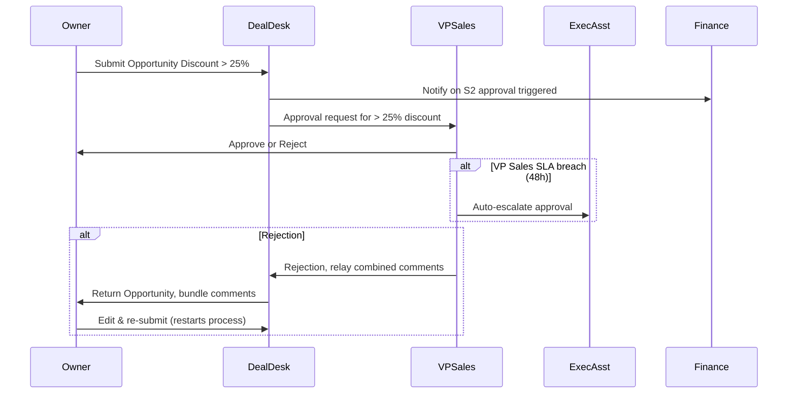

# Technical Specification Document (TSD)

## Project: Discount Approval Enhancement

### Platform: Salesforce
### Module: Opportunity Management
### Surface: Internal (Apex / LWC / Flow)

---

## 1. Solution Overview

This TSD details the technical design for the Discount Approval Enhancement on Salesforce Opportunity records. The enhancement introduces a second-tier, sequential approval for discounts above 25%, strengthens governance, ensures process auditability, and increases visibility for Finance. The solution leverages Salesforce's native object, process automation, notification, and workflow capabilities.

---

## 2. Architecture & Context

### System Context
- **Primary Actors**: Deal Desk, VP Sales, VP Sales Executive Assistant (Delegate), Finance, Opportunity Owner
- **Objects Involved**: Opportunity, ProcessInstance, ProcessInstanceStep, AppvlWorkItemNtfcnEvent
- **Surface**: Salesforce Lightning desktop/mobile; internal users only
- **Integration Points**: Automated notifications (Finance, escalations) via SF email/app event

### Architecture Diagram

#### Opportunity Discount Approval Workflow

Mermaid source:


---

## 3. Functional Requirements Mapping

| **BRD ID** | **Spec Implementation** |
|------------|-------------------------|
| BR-01      | Apex/Flow checks `Discount__c`; triggers second-tier for >25% |
| BR-02      | Flow: sequential approval steps, Deal Desk then VP Sales |
| BR-03      | Automated notification (Apex/Flow + `AppvlWorkItemNtfcnEvent`) on S2 trigger |
| BR-04      | SLA Timer on Flow: Deal Desk (24h), VP Sales (48h) |
| BR-05      | Apex Scheduler or Flow escalation for VP Sales breach |
| BR-06      | ProcessInstance: rejection restarts from Deal Desk |
| BR-07      | Comments aggregation from ProcessInstanceStep; display to Owner |

---

## 4. Detailed Component Design

### Core Components
- **Approval Trigger**: Apex/Flow logic evaluates `Discount__c` on Opportunity save
- **Sequential Approval Workflow**: Salesforce Approval Process, with Flow extension enforcing Deal Desk then VP Sales
- **SLA Enforcement**: Apex Scheduler or Flow-based timers
- **Auto-Escalation**: If VP Sales does not approve in 48h, delegate approval request to Executive Assistant
- **Finance Notification**: Salesforce email/app notification to Finance when S2 triggered and escalation occurs
- **Comments Handling**: Capture, aggregate, and relay all rejection comments to Opportunity Owner
- **Audit Logging**: All actions (approvals, rejections, escalations, notifications) logged in ProcessInstance/ProcessInstanceStep for auditability

### Data Model Extensions
- **Opportunity**: Add:
  - `Second_Tier_Approval_Triggered__c` (Checkbox)
  - `Second_Tier_Approval_Comments__c` (Long Text Area, aggregate rejection comments)
- **ProcessInstance/ProcessInstanceStep**: Existing objects used for approval workflow tracking/comment aggregation
- **Notifications**: Use existing `AppvlWorkItemNtfcnEvent` for Finance and escalation

---

## 5. Process Flow Details

### Workflow Steps
1. **Opportunity Created/Updated**: If `Discount__c` > 25%, trigger second-tier workflow
2. **Deal Desk Approval**: 24 hour SLA; if approved, escalate to VP Sales
   - Failure to respond within 24h: Current process remains unchanged (per BRD)
3. **VP Sales Approval**: 48 hour SLA; if no action, auto-escalate to VP Sales Executive Assistant
   - On approval: process completes, Opportunity closed-won/advanced per stage
   - On rejection: approval chain restarts from Deal Desk, combined comments relayed to Owner
4. **Finance Notification**: Immediate FYI on S2 trigger and on escalation
5. **Audit Logging**: Record action timestamps, actor IDs, comments

### Rejection Handling
- Combined comments captured from Deal Desk and VP Sales
- Owner can edit and resubmit; process restarts from Deal Desk

---

## 6. Non-Functional Requirements (NFRs)

| Characteristic      | Requirement                                   |
|--------------------|-----------------------------------------------|
| Auditability       | 100% of approvals/rejections logged in ProcessInstance/Step |
| Performance        | Workflow execution end-to-end < 2 seconds     |
| Availability       | ≥99.9% (Salesforce SaaS platform SLA)          |
| Notification Latency | <5 seconds for email/app notifications        |
| Data Security      | RBAC—only authorized users can approve/escalate|
| Compatibility      | Salesforce Lightning Web/Desktop & Mobile      |
| Compliance         | Traceable comments, process history retained 7 years |

---

## 7. Security Design

- RBAC: Only Deal Desk, VP Sales, and Executive Assistant can approve/decline; enforced via Salesforce permission sets.
- Audit Logging: All user actions logged.
- Notification Security: Standard Salesforce notification channels; no PII/financials in notification body.
- Field-level Security: Ensure new Opportunity fields visible only to relevant users.
- SLA Timers and Escalations implemented with Salesforce secure scheduled automation.

---

## 8. Exception Handling & Edge Cases

- If Actor (Deal Desk or VP Sales) is unavailable (OOO), Salesforce delegated approval picks up as per standard configuration.
- If SLA breach occurs (no response in allotted time), auto-escalation is triggered; action is logged.
- On rejection at any tier, the process is restarted fully, with bundled rejection comments returned to the Owner.
- Any notification failures are logged via SF error log/Apex exception for admin resolution.

---

## 9. Alternatives Considered

**Alternative 1:** Multi-tier Parallel Approvals
- Rejected – Sequential is required by business for audit/governance clarity.

**Alternative 2:** External (non-Salesforce) Workflow Tools
- Rejected – Salesforce native automation required for maintainability, cost, and compliance.

**Alternative 3:** Only Notify Finance on Final Approval
- Rejected – Business needs visibility when S2 is triggered, not just completion.

---

## 10. Implementation Guidance

- All automation should use Salesforce Flow where possible; Apex only for logic not natively supported.
- Use schema-based field referencing to avoid hardcoded IDs/names.
- Maintain backward compatibility with existing approval flows.
- Explicitly document any custom code post-deployment for compliance.

---

## 11. Compliance & Audit

- All approval/rejection actions and comments retained for 7 years.
- System-level logs (ProcessInstance/Step) configured for monitoring and reporting.
- Ensure all test cases cover edge and failure conditions (UAT + production monitoring with 100% coverage for new approval logic).

---

## 12. Deployment & Rollback Strategy

- Deploy with Salesforce Change Sets; validate in sandbox/UAT.
- Rollback by deactivating new Flow/Apex class and reverting Opportunity page layout changes if needed.
- Notify all stakeholders before/after deployment.

---

## 13. Glossary

- **S2**: Second-Tier Approval
- **Deal Desk**: Centralized team handling first-level approvals
- **VP Sales**: Executive approver for large discounts
- **AppvlWorkItemNtfcnEvent**: Salesforce event for system and user notifications

---

## 14. Rationale & Trade-offs

- **Sequential (Not Parallel) Approval**: Chosen for clarity, governance, and to comply with process requirements.
- **Salesforce-Native Automation over Custom Apps**: Reduces maintenance cost, ensures supportability, and leverages platform guarantees for compliance/audit logging.
- **Immediate Finance Notification**: Ensures compliance, faster reporting, and visibility into policy exceptions.
- **Strict SLA/Timers & Auto-Escalation**: Guarantees timely approvals, reduces lost revenue, and enforces executive accountability.
- **Bundled Comments on Rejection**: Provides feedback clarity for Opportunity Owners and ensures process integrity.

---

## 15. Appendix

### Example: Data Model Extensions
```plaintext
Opportunity
  Discount__c (number: %)
  Approval_Status__c (picklist)
  OwnerId (lookup)
  StageName (picklist)
  Amount (currency)
  Description (string)
  Second_Tier_Approval_Triggered__c (checkbox)
  Second_Tier_Approval_Comments__c (long text)
ProcessInstance/
  TargetObjectId (lookup)
  Status (picklist)
  LastActorId (lookup)
ProcessInstanceStep
  ProcessInstanceId (lookup)
  StepStatus (picklist)
  ActorId (lookup)
  Comments (long text)
```

### Sequence (for Notification & Escalation)
1. Opportunity Discount > 25% triggers two-tier approval.
2. Deal Desk must approve in 24h; else, process follows standard flow.
3. If approved, VP Sales must approve in 48h; else, escalation to Executive Assistant.
4. Rejection at any stage returns bundled comments to Owner; process restarts on resubmission.

---

### Compliance Checklist
- [x] SLAs enforced and auditable
- [x] RBAC applied per role
- [x] All notifications tested
- [x] Approval/rejection actions logged
- [x] New fields documented
- [x] Process documentation delivered

---

## END OF DOCUMENT
