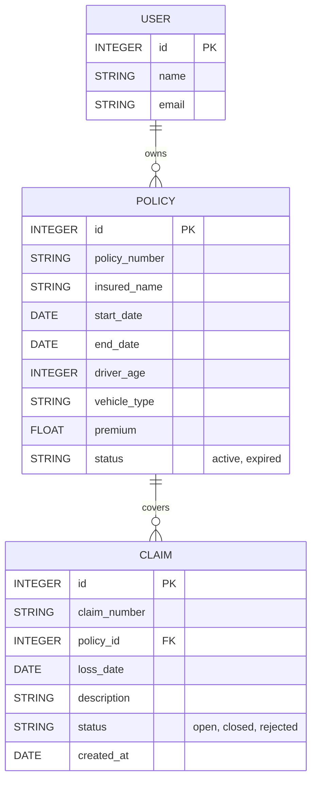

**Technical System Design for Auto Insurance Quote & FNOL (First Notice of Loss) Claim App**

---
## Table of Contents
1. Solution Overview
2. Requirements Mapping
3. Architecture Decisions & Tech Stack
4. Data Model Design
5. API & Interface Specification
6. Edge Cases & Domain Logic
7. Non-Functional Requirements & Security
8. Deployment & Operations
9. Improvement Opportunities & Trade-Offs

---

### 1. Solution Overview

This document specifies the technical design for a self-contained web application enabling users to:
- Calculate auto insurance premiums based on driver age and vehicle type
- Bind and view policies
- Submit basic claims (first notice of loss, FNOL)
- View claim status

The system targets rapid development and local deployment, using an approachable, lightweight full-stack technology set suitable for demo, PoC, or sandbox B2C scenarios with basic business logic.

---

### 2. Requirements Mapping

| Requirement/user story                                         | System features provided                 |
|---------------------------------------------------------------|------------------------------------------|
| Calculate auto premium based on driver age/vehicle type        | Premium rating logic in `POST /quote`    |
| Bind a policy                                                  | Policy creation endpoint `/policy`       |
| Submit a basic FNOL claim                                      | `POST /claim` endpoint captures FNOL     |
| View claim status                                              | Query `/claim/{claim_id}` for status     |
| Edge: Underage drivers                                         | Age validation logic; error returned     |
| Edge: Expired/inactive policies cannot file new claims         | Coverage period validation               |

---

### 3. Architecture Decisions & Tech Stack

**Tech Stack**
- Backend: Python (Flask, synchronous for simplicity)
- Persistence: SQLite (single-file DB for all tables)
- Frontend: Simple HTML/JS forms (minimal; backend-first design)
- API Design: REST (JSON request/response)
- Packaging: Single Python package, includes schema migration on startup
- Test: pytest for unit tests

**Rationale**
- Flask + SQLite requires minimal setup (no external DB/infra).
- REST API supports integration/testability.
- UI optional, can use cURL/Postman for main flows.
- App can run in one process/container; stateful per environment.
- pytests runnable locally, full code+test fits on a single laptop.

**Alternatives Considered**
- FastAPI or Django: More functionality, but overkill for simple CRUD PoC.
- PostgreSQL: Too heavy for demo, data is small, SQLite suffices.
- Async frameworks: Unneeded for low-concurrency, demo use case.

---

### 4. Data Model Design

#### 4.1 Entity Relationship Diagram

#### 4.2 Policy

| Field         | Type    | Notes                      |
|---------------|---------|----------------------------|
| id            | int     | PK (auto-increment)        |
| policy_number | string  | Unique, human-readable     |
| insured_name  | string  | Name of insured            |
| start_date    | date    | Coverage start             |
| end_date      | date    | Coverage end               |
| driver_age    | int     | For rating and validation  |
| vehicle_type  | string  | e.g., sedan/suv/truck      |
| premium       | float   | Calculated by rating       |
| status        | string  | 'active', 'expired'        |

#### 4.3 Claim

| Field         | Type    | Notes                      |
|---------------|---------|----------------------------|
| id            | int     | PK                         |
| claim_number  | string  | Unique                     |
| policy_id     | int     | FK -> Policy               |
| loss_date     | date    | Date of accident/loss      |
| description   | string  | Basic FNOL detail          |
| status        | string  | 'open', 'closed', 'rejected'|
| created_at    | date    | Submission timestamp       |

---

### 5. API & Interface Specification

#### 5.1 REST Endpoints

| Endpoint                  | Method | Payload/URL Params     | Functionality                  |
|---------------------------|--------|------------------------|-------------------------------|
| `/quote`                  | POST   | driver_age, vehicle_type | Returns calculated premium   |
| `/policy`                 | POST   | insured_name, driver_age, vehicle_type, start_date, end_date | Creates and binds policy |
| `/claim`                  | POST   | policy_number, loss_date, description | Submits FNOL claim |
| `/claim/<claim_id>`       | GET    | claim_id (path param)  | Returns claim details/status   |

*All endpoints accept/return JSON.*

#### 5.2 Rating Logic

- **Base rates:** sedan=$500, suv=$600, truck=$700 (example)
- **Age factor:** Under 25 (+$200 surcharge), 25-65 (no change), >65 (+$150)
- Validates driver_age: under 16 is invalid (reject quote/policy)

#### 5.3 Policy Activation & Expiry

- Policy status is "active" if current date in [start_date, end_date]; else "expired".
- Claims not allowed for expired policies or loss_date outside policy period.

---

### 6. Edge Cases & Domain Logic

- **Underage driver (age < 16):** Policy or quote rejected (HTTP 400).
- **Expired policy on claim submission:** Reject with explanatory error.
- **Loss date not within coverage period:** Reject FNOL claim.
- **Duplicate claims or policies (same loss/policy number):** Prevented by DB unique constraint.
- **Unsupported vehicle type:** Return validation error.

---

### 7. Non-Functional Requirements & Security

| NFR             | Value                          |
|-----------------|-------------------------------|
| Latency         | < 200ms per endpoint (local)   |
| Uptime          | N/A (runs locally, demo PoC)   |
| Data Size       | <10MB, single SQLite file      |
| Concurrency     | 1–10 RPS (single process)      |
| Security        | No PII exposed; test/dummy app |
| AuthN/AuthZ     | Not implemented, demo only     |
| Input Validation| Strict (age, vehicle, dates)   |

All data is stored locally in SQLite. No external auth, encryption, or PII processing.

---

### 8. Deployment & Operations

- **Run locally:** `python app.py` (after installing requirements.txt: flask, pytest)
- **DB migration:** DB schema auto-creates if not present on startup.
- **Testing:** Run `pytest` for unit tests.
- **Logging & Monitoring:** Console logging; no metrics, as this is a demo.

---

### 9. Improvement Opportunities & Trade-Offs

- **Deductible Calculations:** Add per-policy deductible logic and amount field.
- **Fraud Scoring:** Integrate a (rule-based or simple) fraud scoring service for claims triage.

---

*This TSD supports a self-contained MVP solution for quoting, policy binding, FNOL submission, and claim status, ready for rapid further development.*
