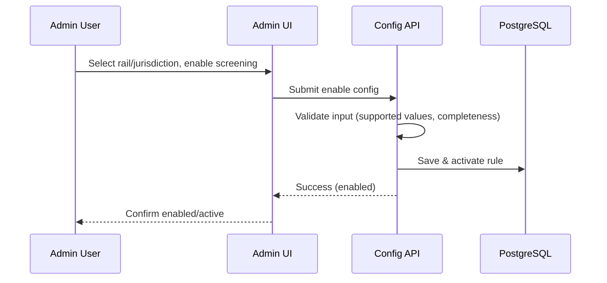
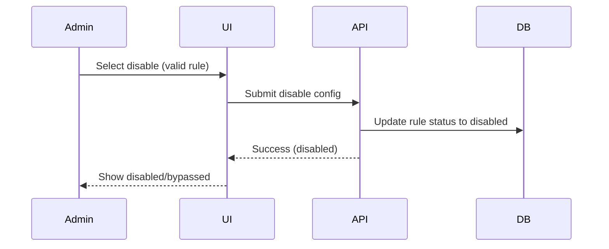
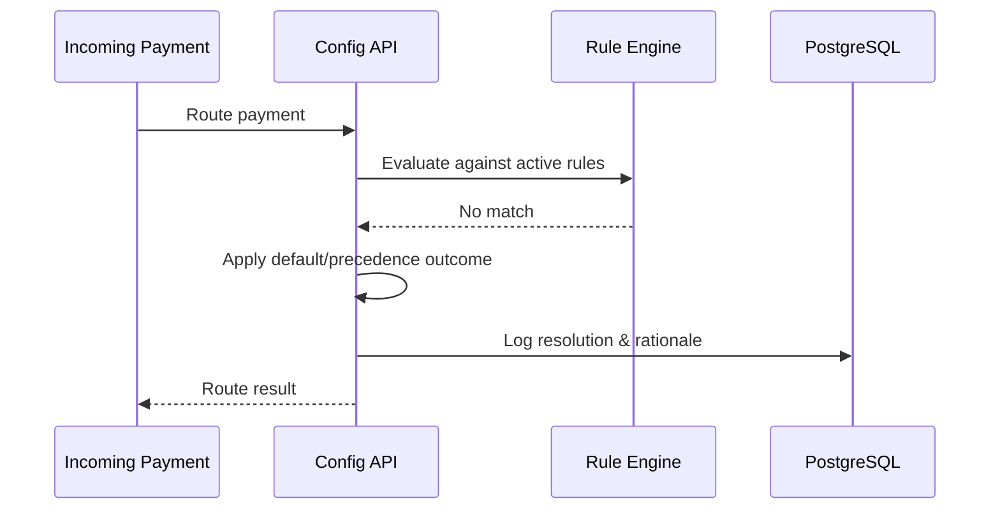
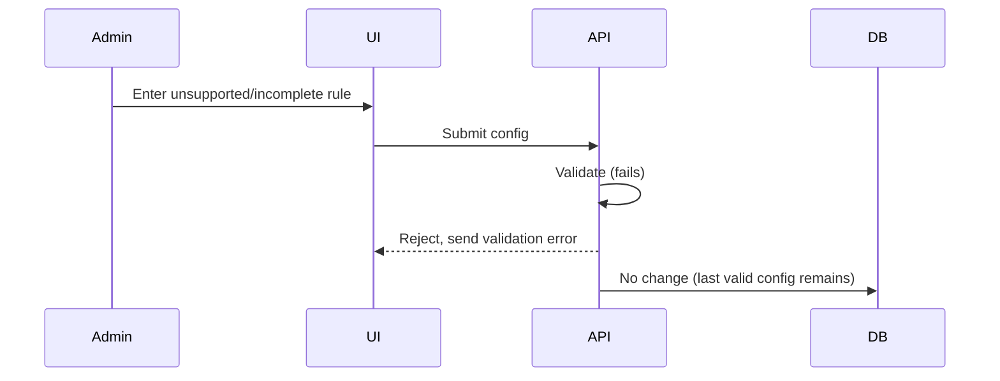

# Technical Specification Document (TSD)
## Sanctions Screening Routing Switch: Rail and Jurisdiction Configuration
**Date:** 2026-11-25  
**Version:** 1.0  
**Status:** Draft

---

## 1. Document Approach

### Project Profile
- **Archetype:** Transactional API + Admin UI for rule-based sanctions screening configuration
- **Interaction Styles:** RESTful HTTP APIs; Web Admin UI; synchronous validation, database writes
- **Integrations:** Payment Attribute Normalization (internal); Postgres (configuration/audit storage); Redis (caching, optional); Kafka (event logging; can be omitted if not in stack)
- **Compliance:** Regulated domain; audit trails; RBAC (admin-only)
- **Scale:** ~5 main components; standard mode (see below)

### Mode
- **STANDARD:** 4–10 components, strict regulatory and audit logging, not exceeding deep complexity. Business risk and compliance sensitivity require complete traceability and validation.

### Technology Stack
- **Backend:** Java 17+, Spring Boot
- **API Gateway:** AWS API Gateway
- **Deployment:** Docker, Amazon EKS (Kubernetes)
- **Database:** PostgreSQL (config & audit)
- **Cache:** Redis (optional, for session/config)
- **Frontend:** React, Angular (Admin UI)
- **Security/Identity:** OAuth 2.0, JWT, RBAC
- **Observability:** OpenTelemetry, Jaeger, Prometheus

### Tailoring Table
| Topic                                 | Included / Omitted | Reason (signal)                                                   |
|---------------------------------------|--------------------|-------------------------------------------------------------------|
| Rule precedence & default logic       | Included           | FR-SCR-04, Jira DoR, compliance, auditability                     |
| Messaging/event design                | Omitted            | No explicit async/broker requirement in stack or BRD              |
| Admin self-service (UI & API)         | Included           | FR-SCR-01/02, role-driven admin configuration                     |
| Legacy migration                      | Omitted            | No legacy platform indicated                                      |
| Payment attribute normalization       | Included           | Dependency per Jira/BRD/governance context                        |
| Security/compliance                   | Included           | NFR-01/02, regulated context, RBAC, audit logging                 |
| Observability & operations            | Included           | NFR-05/06, traceability, reliability, regulator readiness         |

### FR/NFR Traceability Table
| Requirement      | Summary                                                     | Addressed in Section            | Key Design Element                        |
|------------------|-------------------------------------------------------------|-------------------------------|-------------------------------------------|
| FR-SCR-01        | Enable sanctions screening by rail/jurisdiction             | 4, 5, 6                       | Admin UI + Config API                     |
| FR-SCR-02        | Disable sanctions screening                                 | 4, 5, 6                       | Rule logic, Config API                    |
| FR-SCR-03        | Validation of changes                                       | 6, 8                           | Config API validators                     |
| FR-SCR-04        | Rule precedence/default when unmatched                      | 5, 6                           | Decision tables, default processing       |
| FR-SCR-05        | Audit/event logging                                         | 7, 9, 12                       | Audit entity, immutable logging           |
| FR-SCR-06        | RBAC: admin-only access to config                           | 8, 9                           | OAuth2, provider-integration, role matrix |
| FR-SCR-07        | Retrieve config & audit history                             | 7, 8                           | API endpoints, pagination                 |
| FR-SCR-08        | Activation/deactivation semantics                           | 3, 5, 6                        | State field in config + flows             |
| FR-SCR-09        | No silent invalid/partial config effect                     | 3, 6, 9                        | Transactional writes + validation         |
| NFR-01           | IAM/OAuth2 only                                             | 9                              | Provider auth, per-role scopes            |
| NFR-02           | Immutable audit trail, X years                              | 7, 9, 13                       | Write-once entities, archive, retention   |
| NFR-03           | Admin interface ≥99.95% uptime                              | 11, 12                         | EKS, multi-AZ                            |
| NFR-04           | Change validation P95≤2s                                    | 6, 10                          | In-process checks, efficient rules        |
| NFR-05           | Scaling for concurrent admin usage                          | 11, 12                         | EKS HPA, API Gateway quotas               |
| NFR-06           | Resilient to normalization/config store faults              | 4, 11, 12                      | Retries, circuit breaker                  |
| NFR-07           | Change → automated tests + documentation update             | 12, 13                         | Pipelines, version control                |

## 2. Scope, Purpose and Architectural Decisions

### 2.1 Context & Scope
This solution enables Operations/Compliance Administrators to configure sanctions screening rules by payment rail and jurisdiction for CT (cross-border transfer) payments. It supports enabling/disabling screening per scope, rule precedence/default behaviors, complete auditability, and regulatory alignment.

**In Scope:**
- Rule configuration & CRUD by administrators
- Enable/disable by rail/jurisdiction
- Validation and error feedback
- Audit logging, change history
- Rule precedence/default handling
- RBAC authorization; only admins access
- Integration with payment-attribute normalization
- Immediate activation/deactivation

**Out of Scope:**
- Changes to sanction lists or screening algorithm internals
- Payment processing beyond routing decision
- Non-CT payment types
- Legacy migration

### 2.2 Major Architectural Decisions (with rationale and trade-offs)

| Decision                         | Rationale & Trade-off                                                                                    |
|----------------------------------|---------------------------------------------------------------------------------------------------------|
| Spring Boot microservice         | Aligns with enterprise stack, supports modular, testable services. Trade-off: Overhead vs monolith.     |
| PostgreSQL for config & audit    | ACID for transactional config/audit; strong history/query. Trade-off: Scaling audit log may need archiving. |
| React or Angular Admin UI        | Matches frontend standards, fast iteration. Trade-off: Dual stack with Java backend.                    |
| REST APIs via API Gateway        | Standardizes interface and auth; integrates with AWS infra. Trade-off: Potential API rate limits.        |
| Validation on write              | No invalid/partial config can take effect; strong feedback to the admin. Trade-off: Slightly more latency.
| Immutable audit log              | Regulatory/forensic requirements. Trade-off: Retention and volume management overhead.                  |
| RBAC enforced at API             | No direct DB access, only via secured APIs; separation of duties. Trade-off: More complex error paths.   |
| No async/event broker            | Simplicity and speed; no async notification required by requirements.                                   |

### 2.3 Open Assumptions & Uncertainties
- A-01: Business will finalize the default/precedence logic for unmatched payments before go-live.
- A-02: List of supported rails/jurisdictions is maintained externally, not by this system.
- A-03: Audit log retention period matches NFR-02 (X years; specify X per compliance before deployment).

## 3. System Architecture & Component Responsibilities

### 3.1 Architecture Diagram
_The architecture-beta diagram below illustrates component layout and data flow:_

```mermaid
graph TD
    A[Admin UI (React/Angular)]-->|REST|B(API Gateway)
    B-->|REST|C[Configuration API (Spring Boot)]
    C-->|calls|D[Sanctions Rule Engine]
    C-->|calls|E[Payment Attribute Normalization]
    C-->|writes|F[PostgreSQL (Config & Audit)]
    D-->|writes|F
    C-->|cache|G[Redis (optional)]
```
```

### 3.2 Component Responsibility Matrix
| Component                     | Responsibility                                                  |
|-------------------------------|-----------------------------------------------------------------|
| Admin UI                      | Admin rule CRUD, enable/disable, status display                  |
| API Gateway                   | Secures/logs REST API calls, routes to API backend               |
| Configuration API             | Orchestrates config CRUD, validation, RBAC, triggers audit log   |
| Sanctions Rule Engine         | Evaluates payment against rules for routing                     |
| Payment Attribute Normalizer  | Ensures input payment data normalized for matching rules         |
| PostgreSQL                    | Persists config data, audit records                              |
| Redis (optional)              | Speeds up config lookups and sessions                            |

## 4. Key Runtime Flows

### 4.1 Enable Rule – Admin Happy Path


### 4.2 Disable Rule – Admin Happy Path


### 4.3 Routing – Unmatched Scope (Boundary)


### 4.4 Error – Invalid Configuration


## 5. Domain & Business Rules

### 5.1 Rule Enable/Disable Logic
- Only authorized admins can create/disable rules.
- Each rule uniquely scoped to a (rail, jurisdiction) tuple.
- Disabling a rule allows matching CT payments to bypass screening.
- No duplicate or conflicting active rules per scope.

### 5.2 Rule Precedence & Default Behavior
| Situation | Outcome | Rationale |
|-----------|---------|-----------|
| Matching rule enabled   | Screening applied    | Compliance, explicit admin action |
| Matching rule disabled  | No screening        | Authorized bypass, tracked action |
| No matching rule found  | Default/precedence  | Business decision, must be clear & auditable |

### 5.3 Validation Logic
- Only supported rails/jurisdictions accepted (external reference)
- No partially defined (incomplete) rules allowed
- Changes rejected with actionable error, no effect on prior config
- All changes require a complete, atomic write
- Audit trail written for each change (success/failure)

## 6. Data Design

### 6.1 Core Data Entities
| Entity           | Fields                                                           | Notes |
|------------------|------------------------------------------------------------------|-------|
| ConfigRule       | id (UUID), rail, jurisdiction, status (enabled/disabled), createdBy, createdAt, updatedBy, updatedAt, activatedAt, deactivatedAt | `status` field as activation switch. |
| AuditLog         | id, action, ruleId, performedBy, performedAt, result, details     | Write-once, immutable. |

### 6.2 PostgreSQL Schema Example
**ConfigRule Table**
- id: UUID (PK)
- rail: TEXT (FK/ext ref)
- jurisdiction: TEXT (FK/ext ref)
- status: ENUM('enabled','disabled')
- created_by: TEXT (admin user id)
- created_at: TIMESTAMP
- updated_by: TEXT
- updated_at: TIMESTAMP
- activated_at: TIMESTAMP
- deactivated_at: TIMESTAMP

**AuditLog Table**
- id: UUID (PK)
- action: TEXT (enum: create, update, disable, validation_fail)
- rule_id: UUID (FK ConfigRule)
- performed_by: TEXT
- performed_at: TIMESTAMP
- result: TEXT (enum: success, fail)
- details: TEXT/JSONB (optional reason/fields)

### 6.3 Sensitive Data Handling & Retention
- No PII beyond admin identity in logs.
- AuditLog retained for X years per NFR-02/compliance (X set before deployment, assumption A-03).
- Rules and audit logs only managed via API (no direct DB access).
- Regular archive and purge of AuditLog as required after retention.

## 7. API Contracts & Integration

### 7.1 Admin API Endpoints
| Method | Path | Auth | Purpose | Main Request/Response Fields |
|--------|------|------|---------|-----------------------------|
| GET    | /rules        | Admin (JWT, RBAC) | List config rules | [rail, jurisdiction, status] |
| POST   | /rules        | Admin (JWT, RBAC) | Create new rule   | rail, jurisdiction, status   |
| PUT    | /rules/{id}   | Admin (JWT, RBAC) | Update rule       | status                      |
| DELETE | /rules/{id}   | Admin (JWT, RBAC) | Disable rule      | id                          |
| GET    | /audit        | Admin (JWT, RBAC) | List audit logs   | time range, ruleId, result  |
| POST   | /validate     | Admin (JWT, RBAC) | Validate config   | rule spec, dry-run          |

### 7.2 API Design Standards
- All endpoints secured with OAuth2/JWT, role-checked for admin rights.
- OpenAPI 3.0+ spec, JSON request/response, error model with error/info fields.

### 7.3 Integration Points
- Payment Attribute Normalization: Internal API (HTTP/gRPC); batch normalization before rule engine.
- Config Store: All CRUD via Configuration API (no direct writes from UI/admin).
- Audit/Monitoring: Events sent to logging/observability stack (OTel, Prometheus, etc.).

## 8. Security & Compliance

### 8.1 IAM, OAuth2 & RBAC
- Only users with assigned admin roles (enterprise IAM compliance) can access API (see NFR-01, FR-SCR-06).
- JWT tokens validated at API Gateway and backend; RBAC enforced in API layer (Spring Security/PreAuthorize).

### 8.2 Data Protection
- HTTPS (TLS v1.2+) enforced end-to-end.
- No sensitive payment/PII stored in config or audit logs. Only admin/user id recorded.
- PostgreSQL encrypted at rest; access via infra policies.

### 8.3 Audit Logging & Compliance
- Audit events immutable: all config actions, failures, and login events logged.
- AuditLog table is append-only, write-once, retained for X years (A-03).
- Logging covers successful/failed CRUD, all validation errors, and all login/auth failures.

### 8.4 Compliance Posture
- Solution aligns with regulatory requirements (audit, RBAC, validation, change traceability).
- All access paths covered by logs for regulator forensic readiness.

## 9. Non-Functional Requirements & Capacity

### 9.1 Performance Targets
| Metric                           | Target                    | Coverage/Mechanism                      |
|----------------------------------|---------------------------|-----------------------------------------|
| P95 config change validation     | ≤ 2 seconds               | Backend service profile, optimized SQL  |
| P99 admin UI round-trip          | ≤ 5 seconds               | Aggressive caching (Redis), API tuning  |
| Availability                     | ≥ 99.95%                  | EKS multi-AZ, stateless services        |
| Audit log write latency (P95)    | ≤ 1 second                | Async/batched inserts if volume spikes  |

### 9.2 Capacity & Scaling
- Supports min. 50 concurrent admins; scalable to 10x with horizontal pod scaling and API Gateway quotas
- PostgreSQL sized for 5 years of audit log retention (purge/archive older records periodically)
- Redis cache enables <250ms config read latency for real-time flows (optional)

### 9.3 Traceability & Testability
- Every FR/NFR mapped above, see §1.4
- All config actions unit/integration tested (automated test suite)
- Monitoring and auto-alerting for slow validation, failed writes

## 10. Deployment & Operations

### 10.1 AWS EKS Deployment Overview
- All services containerized (Docker) and deployed to Amazon EKS (Kubernetes)
- API Gateway as managed ingress for admin UI and configuration API
- Admin UI hosted as static assets (S3/CloudFront) or as a pod (where required)
- Backend pods autoscale (HPA) based on CPU/latency
- PostgreSQL managed with automated backup & multi-AZ; Redis (if used) as AWS Elasticache
- App config secrets/credentials managed in AWS Secrets Manager

### 10.2 Deployment Diagram
```mermaid
flowchart TD
    UI[Admin UI (S3/CloudFront)]-->APIGW[AWS API Gateway]
    APIGW-->EKS[EKS K8s: Config API Pods]
    EKS-->PG[PostgreSQL (RDS)]
    EKS-->RD[Redis (Elasticache, opt)]
    EKS-->MON[Observability Stack]
    EKS-->SM[AWS Secrets Manager]
```

### 10.3 Backup, Resilience & DR
- PostgreSQL: daily backups, multi-AZ failover, point-in-time restore
- Staged disaster recovery for backend API: automated restarts, pod replacement
- Regular DR drills, recovery time to be within 30 minutes (RTO ≤30m, RPO ≤5m)

## 11. Observability & Operational Readiness

### 11.1 Logging & Monitoring
- Structured JSON logging with correlation and trace IDs
- Real-time metrics: error rates, response times, throughput on admin/config APIs
- Aggregated log and audit data ingested by Prometheus, Grafana dashboards

### 11.2 Tracing & Alerting
- Full distributed tracing with OpenTelemetry, Jaeger
- Alerts: config validation errors, failed audit log writes, unusual admin activity, latency breaches
- Automated tests covering all functional use-cases (integration suite)

### 11.3 Operational Runbook Hooks
- Docs on K8s pod health, log review, config reload, emergency disable, backup restore
- How-to for compliance report generation from audit logs

## 12. Risks, Assumptions, Glossary & References

### 12.1 Risks & Mitigation
| Risk                                               | Impact         | Likelihood | Mitigation                              |
|----------------------------------------------------|----------------|------------|-----------------------------------------|
| Incorrect rule config → compliance breach          | High           | Medium     | Strict validation, audit, RBAC           |
| Default/precedence logic unclear                   | High           | High       | A-01; require business finalization      |
| Audit volume grows beyond affordable storage       | Medium         | Medium     | Archive/purge strategy; S3 cold storage  |
| Unapproved admin role assignment                   | High           | Low        | Tight IAM delegation; audit log all adds |
| PostgreSQL or EKS ops failure                      | High           | Low        | Multi-AZ, backup, runbooks, periodic DR  |

### 12.2 Assumptions (A-xx)
- A-01: Default/precedence outcome to be finalized by business before go-live
- A-02: Supported payment rails/jurisdictions managed outside config system
- A-03: Audit retention period X years, set per compliance at deploy

### 12.3 Glossary
- **CT**: Cross-border Transfer payment
- **RBAC**: Role-Based Access Control
- **CRUD**: Create, Read, Update, Delete
- **Admin UI**: Administrator-facing configuration panel
- **Config Rule**: A rule associating a (rail, jurisdiction) tuple with enabled/disabled status

### 12.4 References
- Jira Ticket SEI-12
- Business Requirements Document (BRD.md)
- Enterprise IAM/OAuth2 standards
- Payment Attribute Normalization specification
