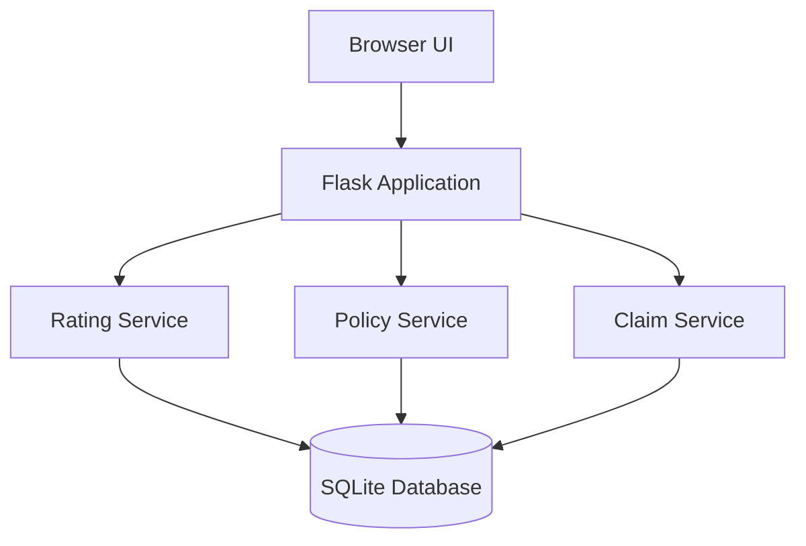
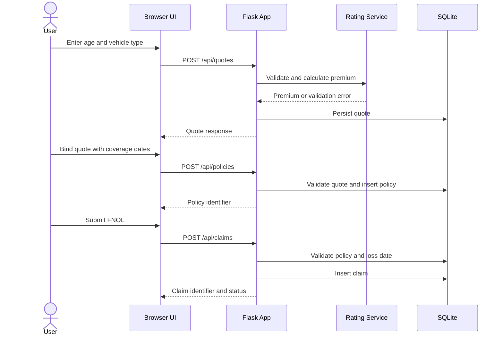
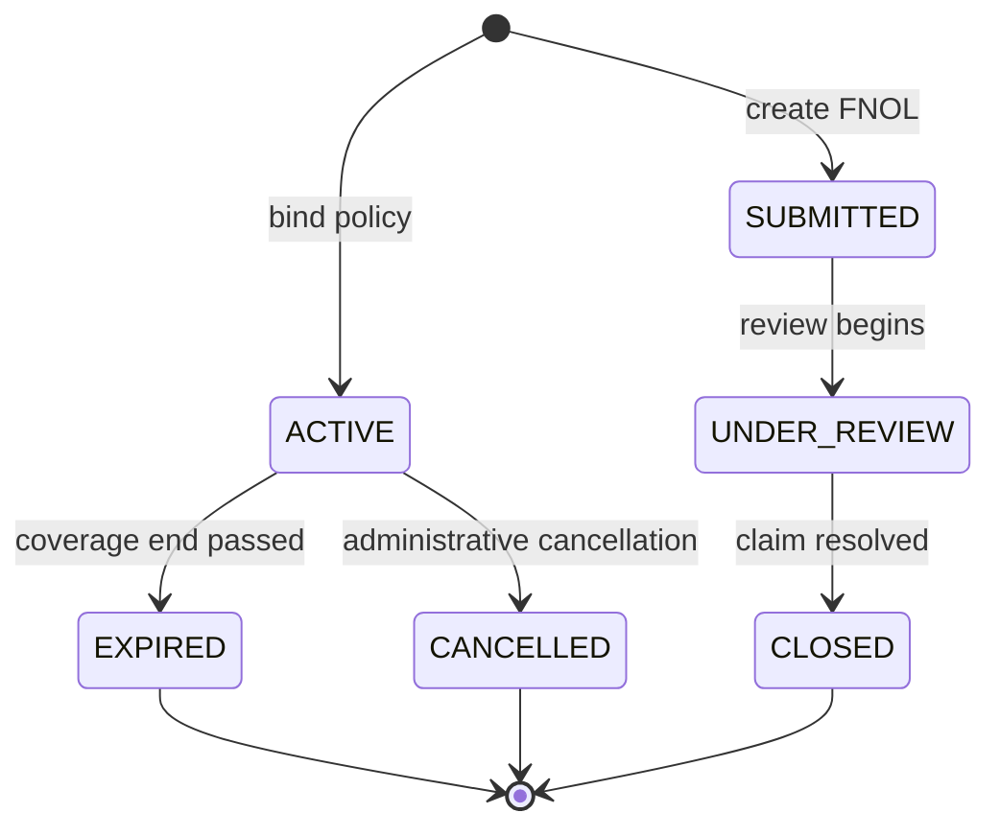
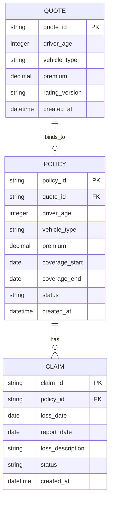
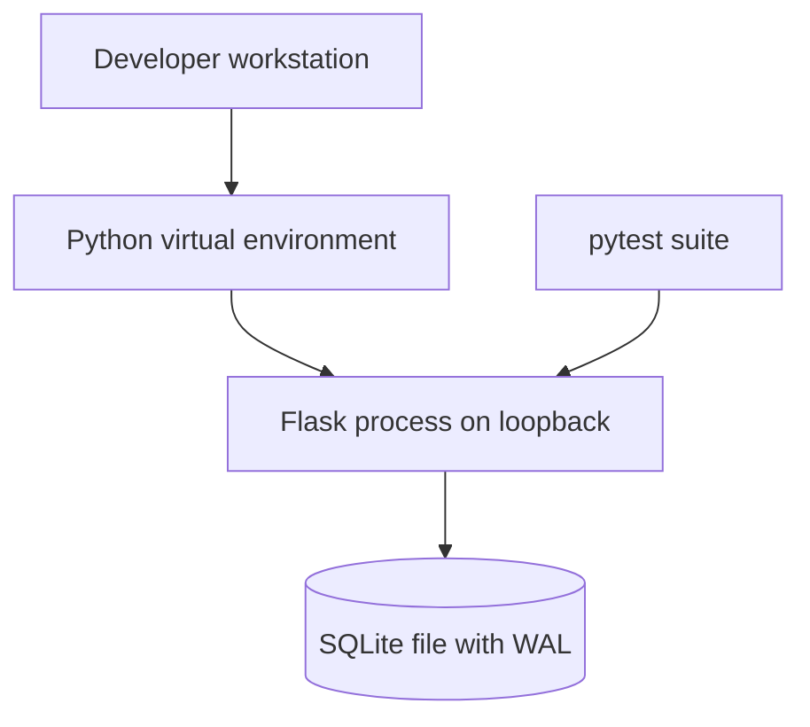

# Technical Specification Document
## Auto Insurance Quote & FNOL Claim Application

**Version:** 1.0  
**Date:** 2026-11-25  
**Status:** Initial technical design  
**Owner:** Architecture

## 1. Document Approach

### 1.1 Project profile

- **Archetype:** self-contained transactional web application with a synchronous REST API and browser UI.
- **Primary capabilities:** indicative premium quotation, policy binding, FNOL claim intake, and claim-status retrieval.
- **Persistence:** local relational persistence for quotes, policies, and claims.
- **Integrations:** none in the initial release; no payment, identity, vehicle, carrier, notification, or fraud integrations.
- **Risk profile:** educational/local demonstration only until authentication, privacy, regulatory, backup, and operational controls are added.

### 1.2 Delivery mode

**LITE mode** is selected because the system has three runtime components (browser UI, Flask application, SQLite), no external integrations, and a small domain model. The design still specifies API contracts, validation, data integrity, security boundaries, deployment, quantified NFRs, and traceability.

### 1.3 Technology stack

| Concern | Decision | Rationale and trade-off |
|---|---|---|
| UI | Server-rendered HTML with progressive JavaScript | Keeps the app self-contained and avoids a separate frontend build. Trade-off: less suitable for a large interactive product than React/Vue. |
| API/runtime | Python 3.12, Flask 3.x, synchronous REST endpoints | Minimal setup and clear separation of handlers and domain services. Trade-off: Flask's synchronous model is sufficient for the target load but not intended for high-concurrency production workloads. |
| Persistence | SQLite 3 through SQLAlchemy 2.x | Zero-install local relational store with transactions and foreign keys. Trade-off: limited concurrent writes and horizontal scale. |
| Validation | Explicit service-layer validation with typed request schemas | Keeps business rules testable independently from HTTP handlers. |
| Packaging | `venv` plus `requirements.txt` | Reproducible local execution without requiring Docker. |
| Testing | pytest with an isolated temporary SQLite database | Fast unit and integration verification of rating and coverage rules. |

### 1.4 Tailoring decisions

| Topic | Included / omitted | Reason |
|---|---|---|
| Architecture and runtime flows | Included | Four linked transactional capabilities require explicit call and validation paths. |
| Domain rules and state lifecycles | Included | Driver eligibility, coverage dates, policy status, and claim status are material business rules. |
| Relational data design | Included | Policy and Claim have referential and date integrity requirements. |
| REST contracts | Included | Browser and API interactions must be implementable consistently. |
| Authentication and authorization | Included at boundary level | BR-26 identifies the gap; local demo uses a trusted environment and production controls are specified as a gate. |
| Async messaging | Omitted | No asynchronous requirement or broker exists in the BRD. |
| External integrations | Omitted | BRD explicitly excludes carrier, payment, identity, fraud, and notification systems. |
| Cloud-native microservices | Omitted | The requested app is lightweight and self-contained; a modular monolith avoids distributed-system overhead. |

## 2. Scope and Architectural Decisions

### 2.1 In scope

The application calculates a premium from driver age and vehicle type, creates a policy from an eligible quote, accepts a basic FNOL against a valid policy, and retrieves claim status. It persists identifiers, rating inputs, premium, coverage dates, status, descriptions, and timestamps.

### 2.2 Out of scope

Payment, authentication, customer accounts, full underwriting, policy endorsements/cancellations workflow, claims adjudication/settlement, document uploads, notifications, fraud scoring, deductible calculation, and production regulatory workflows are excluded.

### 2.3 Key decisions

1. **Modular monolith over microservices:** one deployable Flask application provides clear modules (`rating`, `policies`, `claims`) and a single SQLite transaction boundary. This minimizes setup and operational cost; the trade-off is that independent scaling is unavailable.
2. **Quote persisted before binding:** a quote receives a stable identifier and rating version. Binding references that quote and copies the rated inputs and premium, preventing silent repricing.
3. **Inclusive coverage dates:** loss dates equal to `coverage_start` or `coverage_end` are covered. This resolves the BRD boundary assumption deterministically.
4. **UTC timestamps and ISO dates:** timestamps are stored in UTC; date-only policy and loss dates use `YYYY-MM-DD`.
5. **Business rules in services, not routes:** route handlers translate HTTP requests; domain services own rating, eligibility, and coverage decisions. This permits direct unit testing without a web server.

## 3. System Architecture

### 3.1 Logical topology



> Diagram validation was attempted through the diagram renderer, but the renderer returned a platform error. The block is intentionally limited to standard Mermaid `graph TD` syntax.

### 3.2 Component responsibilities

| Component | Responsibilities | Must not do |
|---|---|---|
| Browser UI | Collect inputs, call REST endpoints, render quote/policy/claim responses and validation messages | Calculate authoritative premiums or decide coverage locally |
| Flask HTTP layer | Routing, JSON/form parsing, HTTP status mapping, request correlation ID, response serialization | Contain rating or eligibility formulas |
| Rating service | Validate age/type, apply versioned rate table, round premium to cents, create quote | Bind policies or inspect claim data |
| Policy service | Validate quote and dates, create policy, expose active/expired determination | Accept claims directly |
| Claim service | Validate policy existence/status and loss coverage, create claim, return status | Modify policy coverage or premium |
| SQLAlchemy repository layer | Transactions, queries, foreign keys, indexes, persistence errors | Apply UI-specific behavior |

### 3.3 Module layout

```text
app/
  __init__.py             # Flask factory and configuration
  routes/
    quotes.py
    policies.py
    claims.py
  domain/
    rating.py
    policy_service.py
    claim_service.py
    errors.py
  models.py               # Quote, Policy, Claim ORM models
  repositories.py
  templates/
  static/
tests/
  test_rating.py
  test_policy_claim_validation.py
run.py
requirements.txt
```

The application factory creates the database engine, enables SQLite foreign keys, registers routes, and injects configuration. Services receive repositories through constructor parameters so tests can use an isolated database.

## 4. Domain Rules and Runtime Flows

### 4.1 Rating rules

The initial implementation uses a deterministic, versioned rate table. These values are explicit design assumptions because the BRD requires the business to approve final rates before production:

| Rule | Value |
|---|---:|
| Minimum eligible driver age | 18 years |
| Age 18–24 multiplier | 1.50 |
| Age 25–64 multiplier | 1.00 |
| Age 65+ multiplier | 1.20 |
| Base premium: sedan | 600.00 |
| Base premium: SUV | 750.00 |
| Base premium: sports | 1,000.00 |
| Currency and precision | USD, 2 decimal places |
| Formula | `base_premium(vehicle_type) × age_multiplier(age)` |
| Rating version | `v1` |

Age must be an integer from 0 through 120 at input validation. Ages below 18 are declined with `DRIVER_UNDERAGE`; unknown vehicle types are rejected with `UNSUPPORTED_VEHICLE_TYPE`. Premium rounding uses decimal arithmetic with half-up rounding, never binary floating-point arithmetic.

### 4.2 Policy rules

- A policy can be bound only from an existing quote that is not already bound.
- `coverage_start` must be a valid ISO date.
- `coverage_end` must be strictly later than `coverage_start`.
- Newly bound policies have status `ACTIVE`.
- A policy is claim-eligible only when its stored status is `ACTIVE` and the loss date is between the coverage dates inclusively.
- Runtime status evaluation treats an `ACTIVE` policy with a current date after `coverage_end` as expired for claim validation; the record is not silently mutated during a read.
- A quote is bound at most once, enforced by a unique constraint on `policy.quote_id`.

### 4.3 FNOL rules and edge cases

- The policy identifier must exist.
- The policy must be `ACTIVE`.
- Loss date and report date must parse as ISO dates.
- Loss date must satisfy `coverage_start <= loss_date <= coverage_end`.
- Report date must be on or after loss date; this is a conservative operational assumption and returns `REPORT_BEFORE_LOSS` when violated.
- Loss description must be 10–2,000 characters after trimming.
- A valid submission creates a claim with status `SUBMITTED`.
- An unknown claim identifier returns HTTP 404 and never creates a record.
- Duplicate submissions are not automatically deduplicated in the basic release; clients should retain the returned claim ID. A future idempotency key is recommended before production use.

### 4.4 Main transaction flow



### 4.5 Lifecycle states



The application implements `ACTIVE`, `EXPIRED`, `CANCELLED` policy values and `SUBMITTED`, `UNDER_REVIEW`, `CLOSED` claim values. Only creation of `ACTIVE` policies and `SUBMITTED` claims is in the initial API; subsequent transitions require an operations capability in a later release.

## 5. Data Design

### 5.1 Relational model



### 5.2 Entity constraints and indexes

| Entity | Fields and constraints |
|---|---|
| `quote` | `quote_id` UUID string primary key; `driver_age` integer; `vehicle_type` constrained by service to `sedan`, `suv`, `sports`; `premium` numeric(10,2); `rating_version` required; `created_at` UTC required. |
| `policy` | `policy_id` UUID primary key; `quote_id` foreign key and unique; copied rating inputs; `coverage_start`, `coverage_end`; `status` constrained to lifecycle values; `created_at` UTC. |
| `claim` | `claim_id` UUID primary key; `policy_id` foreign key; `loss_date`, `report_date`; `loss_description`; `status`; `created_at` UTC. |

Indexes: `policy(quote_id)` unique, `policy(status, coverage_end)`, `claim(policy_id, loss_date)`, and `claim(status, created_at)`. SQLite foreign keys are enabled on every connection. Each bind and claim submission uses one transaction; failed validation rolls back with no partial record.

### 5.3 Retention and integrity

For the local demonstration, data is retained in the SQLite file until explicitly deleted. The application must not claim production retention compliance. A production migration should move to PostgreSQL, add authenticated subjects, immutable audit records, encrypted backups, and a documented retention schedule. SQLite WAL mode is enabled for better read concurrency; a single application process is the supported local topology.

## 6. REST API Contracts

All endpoints are under `/api/v1`, accept and return JSON, and use `Content-Type: application/json`. Responses include `request_id` for troubleshooting. The browser may use the same endpoints; HTML rendering is a thin client.

| Method and path | Request | Success | Key errors |
|---|---|---|---|
| `POST /quotes` | `{ "driver_age": 30, "vehicle_type": "sedan" }` | `201 { quote_id, premium, currency, rating_version, eligible }` | `400 INVALID_INPUT`, `422 DRIVER_UNDERAGE`, `422 UNSUPPORTED_VEHICLE_TYPE` |
| `POST /policies` | `{ "quote_id": "...", "coverage_start": "2026-12-01", "coverage_end": "2027-11-30" }` | `201 { policy_id, quote_id, premium, status, coverage_start, coverage_end }` | `404 QUOTE_NOT_FOUND`, `409 QUOTE_ALREADY_BOUND`, `400 INVALID_COVERAGE_DATES` |
| `GET /policies/{policy_id}` | none | `200` policy representation | `404 POLICY_NOT_FOUND` |
| `POST /claims` | `{ "policy_id": "...", "loss_date": "2027-01-10", "report_date": "2027-01-11", "loss_description": "Rear-end collision at intersection" }` | `201 { claim_id, policy_id, loss_date, report_date, status }` | `404 POLICY_NOT_FOUND`, `422 POLICY_NOT_CLAIM_ELIGIBLE`, `422 LOSS_OUTSIDE_COVERAGE`, `400 INVALID_CLAIM_DATES`, `422 REPORT_BEFORE_LOSS` |
| `GET /claims/{claim_id}` | none | `200` claim representation | `404 CLAIM_NOT_FOUND` |

### 6.1 Standard error shape

```json
{
  "error": {
    "code": "LOSS_OUTSIDE_COVERAGE",
    "message": "The loss date is outside the policy coverage period.",
    "field": "loss_date"
  },
  "request_id": "4be0643f-..."
}
```

Messages are actionable but do not include SQL, stack traces, filesystem paths, or secrets. HTTP mapping is stable: malformed JSON or missing fields `400`, unknown resources `404`, business conflicts `409`, and validly formed but ineligible business requests `422`.

### 6.2 Service pseudocode

```python
def calculate_premium(age: int, vehicle_type: str) -> Decimal:
    validate_age(age)                 # 18..120; underage is a domain error
    base = BASE_PREMIUMS[vehicle_type] # unknown type is a domain error
    multiplier = age_multiplier(age)
    return (base * multiplier).quantize(Decimal("0.01"), ROUND_HALF_UP)


def submit_claim(policy, loss_date, report_date, description):
    if policy.status != "ACTIVE":
        raise PolicyNotClaimEligible()
    if not policy.coverage_start <= loss_date <= policy.coverage_end:
        raise LossOutsideCoverage()
    if report_date < loss_date:
        raise ReportBeforeLoss()
    return claim_repository.insert(..., status="SUBMITTED")
```

## 7. Security and Privacy

### 7.1 Initial local boundary

The local demonstration binds to `127.0.0.1` by default and does not expose a public listener. Flask debug mode is disabled outside an explicit developer setting. `SECRET_KEY` and database paths are supplied through environment variables; no credentials are committed to source control.

Because BRD-26 provides no identity requirements, the initial API has no authentication or authorization. This is acceptable only for a trusted local environment and is a release blocker for internet exposure. Production must add OIDC/OAuth2 authentication, policyholder ownership checks, claims-operations roles, rate limiting, CSRF protection for cookie sessions, TLS, and security logging.

### 7.2 Data protection controls

- Validate and length-limit all incoming strings; use SQLAlchemy parameter binding.
- Store only the minimum fields in scope; do not collect government IDs, payment details, or unnecessary sensitive data.
- Mask identifiers in logs except for a short correlation-safe suffix.
- Restrict SQLite file permissions to the application user.
- Run dependency scanning and pin versions in `requirements.txt`.
- Use HTTPS and encrypted managed database storage before any shared deployment.
- Record creation timestamps and request IDs for operational auditability; do not present the local log as a regulatory audit trail.

## 8. Local Deployment and Delivery

### 8.1 Run locally

```bash
python3.12 -m venv .venv
source .venv/bin/activate          # Windows: .venv\\Scripts\\activate
pip install -r requirements.txt
export DATABASE_URL=sqlite:///./insurance.db
export FLASK_ENV=production
python run.py
```

Open `http://127.0.0.1:5000`. Database tables are created through an explicit initialization command or application startup migration for the demo. A production implementation should use Alembic migrations rather than implicit schema creation.

### 8.2 Deployment topology



The supported deployment is one Flask process and one SQLite file. If multiple workers or hosts are required, migrate to PostgreSQL before scaling; do not place a shared SQLite file on a network filesystem. CI should run formatting, static checks, unit tests, API tests, dependency scanning, and a clean-start smoke test on every pull request.

### 8.3 Release gates

A release is accepted only when the test suite passes, schema initialization succeeds from an empty database, all required API error codes are stable, and the three rating tests plus two coverage validation checks are green. Public deployment additionally requires authentication, TLS, secret management, backup/restore validation, and a privacy review.

## 9. Quality Attributes, Operations, and Resilience

### 9.1 Quantified NFR targets

| Attribute | Initial target | Design mechanism | Verification |
|---|---:|---|---|
| Quote API latency | ≤250 ms p95 for 20 requests/second on a developer laptop | In-process rating table, indexed SQLite writes | pytest benchmark and load test |
| Policy/claim API latency | ≤350 ms p95 for 10 requests/second | Single transaction and indexed foreign-key lookups | API load test |
| Throughput | 20 quote requests/second and 10 write requests/second | One process; scale requires PostgreSQL and multiple workers | 60-second load test |
| Availability | 99.0% during planned local demonstration windows | Process restart and database integrity checks | Smoke monitoring |
| Data durability | RPO 24 hours and RTO 4 hours for a backed-up local database | Daily copy of SQLite file while quiesced; documented restore | Restore drill |
| Validation correctness | 100% pass rate for mandatory rule tests | Pure service functions and deterministic rate version | pytest gate |
| Startup | ≤5 seconds from process launch to healthy endpoint | Small app and local schema check | CI smoke test |
| Cost | ≤$10/month incremental infrastructure for local/demo hosting | Local process and SQLite; no managed services | Monthly cost review |

The availability, RPO/RTO, and cost targets apply to a controlled demonstration. They are not production insurance-service commitments.

### 9.2 Observability

| Signal | Implementation | Alert or action |
|---|---|---|
| Structured logs | JSON logs containing timestamp, level, route, status, duration, request ID, and error code | Investigate any unhandled 5xx; never log request bodies by default |
| Metrics | Counters for quotes, policy binds, FNOL accepted/rejected; histogram for route latency; gauge for DB connectivity | Alert on 5xx >2% over 5 minutes or DB health failure |
| Tracing | Request ID propagation through route and service logs; OpenTelemetry is optional only when deployed beyond local mode | Correlate a failed user transaction across layers |
| Health | `GET /healthz` checks process; `GET /readyz` checks database query | Do not accept traffic when readiness fails |

### 9.3 Failure handling

- Database lock or transient operational errors return HTTP 503 with a request ID; the client may retry only idempotent GET requests.
- Validation errors are not retried.
- UUIDs are generated before insert and returned only after commit.
- A failed transaction leaves no policy or claim record.
- A corrupt or missing database stops readiness and emits a high-severity startup log rather than silently recreating data.

## 10. Testable Engineering Baseline

The architecture requires these focused tests; the QA phase may expand them without changing the design boundary:

1. **Standard rating:** age 30, sedan → `600.00`.
2. **Young-driver rating:** age 20, SUV → `1125.00` (`750.00 × 1.50`).
3. **Senior-driver rating:** age 70, sports → `1200.00` (`1000.00 × 1.20`).
4. **Coverage-before-start validation:** loss date before `coverage_start` → `LOSS_OUTSIDE_COVERAGE`, no claim row.
5. **Expired/after-end validation:** loss date after `coverage_end` or policy status `EXPIRED` → `POLICY_NOT_CLAIM_ELIGIBLE` or `LOSS_OUTSIDE_COVERAGE`, no claim row.

Additional mandatory checks cover underage drivers, unsupported vehicle types, invalid policy dates, unknown policy IDs, unknown claim IDs, and report date before loss date. Tests should assert both HTTP error contracts and database non-creation for rejected writes.

## 11. Future P&C Enhancements

1. **Deductible and coverage calculation:** add coverage selections, deductible options, limits, and transparent premium adjustments. Store the selected product/rating version on the policy so historical calculations remain reproducible.
2. **Fraud and anomaly scoring:** add a separately versioned risk service that evaluates claim signals asynchronously, stores an explainable score and model version, and routes high-risk claims for manual review. It must not silently deny coverage or replace claims operations decisions.

Further production evolution includes PostgreSQL migration, OIDC identity, payment integration, document/photo upload with malware scanning, notifications, adjuster assignment, and audited status transitions.

## 12. Risks, Assumptions, and Constraints

### 12.1 Assumptions

| ID | Assumption and design consequence |
|---|---|
| A-01 | Minimum eligible age is 18; business must approve before production. |
| A-02 | Vehicle types are `sedan`, `suv`, and `sports`; unsupported values are rejected. |
| A-03 | Rates, USD currency, half-up cents rounding, and rating version `v1` are demonstration assumptions. |
| A-04 | Coverage start and end dates are inclusive. |
| A-05 | Report date cannot precede loss date. |
| A-06 | The application runs in a trusted local environment without authentication; public use requires the security controls in §7. |
| A-07 | Initial status values are `ACTIVE` for policies and `SUBMITTED` for claims. |

### 12.2 Risks and mitigations

| Risk | Impact | Mitigation |
|---|---|---|
| Business rates or eligibility change | Incorrect premium or acceptance decision | Version rate tables and keep business configuration outside route code; approve values before release |
| SQLite write contention | Failed or slow concurrent binds/claims | Keep one-process scope; migrate to PostgreSQL before multi-worker deployment |
| Unauthenticated access | Unauthorized policy/claim disclosure | Loopback-only default; treat OIDC and ownership authorization as production gates |
| Duplicate FNOL submissions | Duplicate claims | Add an idempotency key and deduplication rule before production |
| Local file loss | Lost policies and claims | Daily quiesced backups for demo; managed database and tested backups for production |
| Minimal FNOL fields | Insufficient claim handling context | Add cause, location, contact, photos, and coverage checks in the claims roadmap |

## 13. Requirements Traceability

| BRD requirement | Design response |
|---|---|
| BR-01–BR-03 | §4.1 rating inputs, formula, version, and `POST /quotes` |
| BR-04–BR-05 | §4.1 age eligibility and deterministic versioned calculation |
| BR-06–BR-09 | §4.2 policy rules, unique quote binding, §6 policy API |
| BR-10–BR-16 | §4.3 FNOL rules, §6 claim API, transactional claim service |
| BR-17–BR-19 | `GET /claims/{claim_id}`, claim lifecycle in §4.5, 404 contract in §6 |
| BR-20–BR-21 | §6.1 stable errors, service-layer validation, transaction rollback |
| BR-22 | §1 UI decision and browser component in §3.2 |
| BR-23–BR-24 | §5 relational constraints, foreign keys, indexes, and persistence policy |
| BR-25 | UTC timestamps, request IDs, and structured logs in §9.2 |
| BR-26 | §7 local security boundary and production security gates |
| BR-27 | deterministic services, explicit failure handling, and §10 test baseline |
| BR-28 | versioned rating table, explicit enums, and modular domain services |

## 14. Implementation Acceptance Boundary

This TSD is complete when a developer can create the three models, implement the three domain services, expose the five endpoint groups, run the local app from an empty database, and execute the five mandatory tests without external systems. Code, standalone test plans, and user-story artifacts are intentionally not generated by this architecture document; they are implementation work downstream of this TSD.
