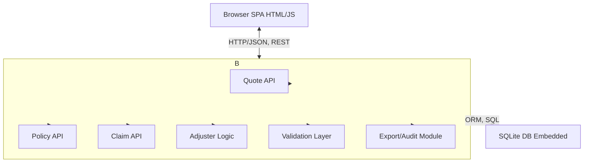

# Technical System Design (TSD)

## 1. System Overview

The Property & Casualty (P&C) Insurance Web Application provides an end-to-end, local, and dependency-free solution for quoting, policy issuance/administration, and FNOL (First Notice of Loss) claims. It is implemented with Python 3.11+ (FastAPI backend), SQLite (embedded RDBMS), and a SPA HTML/JavaScript frontend. All features strictly enforce the P&C business rules for data integrity, eligibility, coverage, and claim validation, fulfilling the requirements set by the Business Requirements Document (BRD).

Key functional domains:
- **Quote**: Enables real-time quote generation with detailed eligibility and regulatory checks.
- **Policy Administration**: Full policy lifecycle management with consistent policy numbering, versioning, and compliance.
- **FNOL/Claims**: Guided first notice of loss submission, including loss type/cause validation and adjuster assignment.

All workflows are fully traceable, auditable, and designed for transparency in a regulated insurance context. 


## 2. Technical Objectives & Quality Attributes

- **Traceability**: Direct mapping from requirements (BRD) to design, implementation, and test artifacts.
- **Performance**: 95% of all valid API operations complete within 2s with 10 concurrent sessions on commodity hardware.
- **Robust Validation**: All business rules enforceable at API, data, and UI layers—inputs rejected on any rule failure.
- **Auditability**: Full policy/claim versioning, data retention, and traceable changes in SQLite for post-facto audit.
- **Offline Operation**: No external dependencies; all logic and data in local, reproducible code and database.
- **Accessibility & Usability**: SPA frontend supports screen readers and keyboard navigation (WCAG 2.1 AA), tested at 1080p.
- **Extensibility**: Clean separation of model, API, and UI layers for streamlined future extension (e.g., new coverage, fraud detection).

## 3. Solution Traceability Matrix

| BRD Ref  | System Component                     | Design Section(s)         |
|----------|--------------------------------------|---------------------------|
| BR-01    | Quote Service (API, Model, Frontend) | 4, 5, 6                   |
| BR-02    | Policy Model, Number Generator       | 5, 6                      |
| BR-03    | UI/Session State                     | 4, 6                      |
| BR-04    | Quote Validation, Policy Issue Flow  | 4, 6                      |
| BR-05    | Policy Issue Endpoint/Model          | 4, 5, 6                   |
| BR-06    | Policy Search APIs, Frontend         | 4, 5, 6                   |
| BR-07    | Policy Status Model, Data Access     | 5, 6                      |
| BR-08    | Export Logic, Model Histories        | 5, 8                      |
| BR-09    | Claim Coverage Validation            | 4, 6, 7                   |
| BR-10    | Claim Submission API, Validations    | 4, 6, 7                   |
| BR-11    | Adjuster Assignment Algorithm        | 4, 6                      |
| BR-12    | Validations/Audit Log                | 6, 8                      |
| BR-13    | FNOL ID Generation Logic             | 5, 6                      |
| BR-14    | FNOL Submission Workflow/API         | 4, 6                      |
| BR-15    | Policy and Claim Validity Checks     | 5, 6, 7                   |
| BR-16    | Coverage Matching Logic              | 5, 6, 7                   |

## 4. System Architecture

### 4.1 Architectural Overview

The system adopts a modular, layered architecture, facilitating strict separation between frontend (SPA), API (FastAPI), and storage (SQLite), co-located for offline, zero-dependency operation.



#### Components:
- **Frontend SPA**: Single-page HTML/js with AJAX calls for all data operations. Guides user through permitted workflows; prevents mix of policy/claim search per session (BR-03).
- **API Layer (FastAPI)**: Implements all business logic, validation, CRUD for quote/policy/claim per established business rules.
- **Persistence (SQLite)**: Normalized schema. All actions—policy, version, claim, audit—saved for integrity and auditability; enables exporting for post-hoc review (BR-08).
- **Validation/Business Rules Module**: Centralizes all validation; called by endpoints and data layer. Ensures rules enforced at every stage.
- **Adjuster Assignment**: Assigns claims only to adjusters licensed in policy country (BR-11).
- **Audit/Export**: Full history (policy/claim/event/version) exportable for regulatory checks.

### 4.2 UI/API Interaction Pattern
- All workflow and data validation occurs API-first. The SPA only allows UI navigation that is possible under the current session's validity and rules.
- No backend communications to external systems.
- Error reporting and validation failures are communicated via HTTP status codes with descriptive JSON error payloads.

### 4.3 Technology Justification
- **FastAPI**: Chosen for its performance (async), strong OpenAPI generation, and straightforward integration with Python 3.11+.
- **SQLite**: Embedded, reliable, zero-administration RDBMS. Satisfies requirements for offline operation and data auditability.
- **SPA (HTML/JS)**: Ensures a modern, accessible user experience and enables responsive, real-time validation with browser compatibility.

## 5. Data Model & Schema (ERD)

### 5.1 Entity-Relationship Diagram
```mermaid
erDiagram
    CUSTOMER ||--o{ POLICY : owns
    POLICY ||--o{ POLICYVERSION : versions
    POLICY ||--o{ CLAIM : covers
    CLAIM }o--|| ADJUSTER : assigned_to
    POLICYVERSION ||--o{ COVERAGE : includes
    CLAIM }o--|| COVERAGE : valid_for

    CUSTOMER {
      int id PK
      string name
      string address
      string country
    }
    POLICY {
      int id PK
      string policy_number (format: PR########)
      int customer_id FK
      string status
      date effective_date
      date expiry_date
    }
    POLICYVERSION {
      int id PK
      int policy_id FK
      int version_number
      date issued_at
      string change_summary
    }
    COVERAGE {
      int id PK
      int policyversion_id FK
      string coverage_type (P/B)
      string cause_code
    }
    CLAIM {
      int id PK
      string claim_number (18-char alphanumeric)
      int policy_id FK
      int coverage_id FK
      date loss_date
      string loss_type
      string cause_code
      float estimated_loss
      string status
      int adjuster_id FK
    }
    ADJUSTER {
      int id PK
      string name
      string country_licensed
    }
```

### 5.2 Rationale
- **SQLite** is ideal for local, demo, and audit-friendly deployments. All database actions are transactionally safe and auditable off a single .db file.
- Data normalization eliminates redundancy, supporting policy versioning (required by BR-05, BR-08) and loss mapping to coverage/cause (BR-09).
- Foreign keys enforce referential integrity on policy, customer, and claim relations. Status fields/range rules implemented in model layer.

### 5.3 Core Table/Field Notes
- `policy_number` is unique and must match PR + 8 digits.
- Policy versioning supports update/audit trail.
- `claim_number` generated per BR-13; enforced unique, linked to policy and coverage.
- `coverage_type`, `cause_code` strictly enumerated per BR-09—only allowed pairs in COVERAGE, CLAIM.
- Timestamp (issued_at/loss_date) fields are type-checked and compared against policy effective/expiry for all validation (BR-10, BR-15).

## 6. API Design & Validation Responsibilities

### 6.1 API Endpoint Overview
- **/api/quote** (POST): Submit new quote request
  - Validates all customer, property, coverage, and eligibility fields
  - Checks policy number format, demographic, regulatory data in line with BR-01, BR-02
  - Error: HTTP 422 with JSON error details on validation failure
- **/api/policy** (POST/GET): Issue policy, search/view policies
  - Validates quote eligibility before policy issuance (BR-04, BR-05)
  - GET supports filters by policy_number, customer, status, etc.
  - Policy versioning (see BR-05, BR-08) handled by version field
- **/api/claim** (POST/GET): Submit and query FNOL claims
  - Checks active/valid policy, coverage, cause, loss type and value (BR-09, BR-10, BR-15, BR-16)
  - Assigns adjuster based on country matching (BR-11)
  - Generates claim number per BR-13, returns unique code
- **/api/export** (GET): Download policy/claim audit reports (CSV, JSON support)

### 6.2 Input/Output Schemas (OpenAPI outline)
- **QuoteRequest**: customer (object), property (object), coverage_type (string, enum), policy_number (string, PR########)
- **PolicyRequest**: policy_number (string), customer_id, coverages (array of coverage_type+cause_code), versioning handled
- **ClaimRequest**: policy_number, loss_date, loss_type/cause_code (enum), estimated_loss (float, >0)
- **AdjusterAssignment**: calculated; not directly input

### 6.3 HTTP Validation Matrix
| Endpoint         | Validation                                                     | On Failure      |
|------------------|----------------------------------------------------------------|-----------------|
| /api/quote       | Policy# format, all fields present/valid                       | 422 JSON error  |
| /api/policy      | Existing quote valid, policy active, version correct           | 422 JSON error  |
| /api/claim       | Policy active/inforce/valid, coverage/cause valid, dates valid | 422 JSON error  |
| /api/export      | N/A (audit only)                                               | 400/404 error   |

All endpoints return OpenAPI-spec JSON error messages with field-level details. Downstream and UI audits use same validation logic (BR-12).

## 7. Business Rules Traceability Matrix

| Business Rule ID | Rule Description                                                                        | Enforced In                                             |
|------------------|----------------------------------------------------------------------------------------|---------------------------------------------------------|
| BR-01            | Quote requires all eligibility, demographic, regulatory requirements                    | /api/quote, Validation module, Frontend                  |
| BR-02            | Policy number must be "PR" + 8 digits format                                           | All APIs, DB schema constraint                           |
| BR-03            | Exclusive search: policy or claim per session                                           | UI session state, Frontend                              |
| BR-04            | Only eligible quotes progress to policies                                               | /api/policy, Validation                                 |
| BR-05            | Policy issuance: integrity checks, versioning supported                                 | /api/policy, PolicyVersion table                        |
| BR-06            | Real-time policy/coverage verification                                                  | /api/policy, /api/claim, Validation                     |
| BR-07            | Only valid, existing policies modifiable                                                | /api/policy, DB status checks                           |
| BR-08            | Auditable/viewable/exportable policies                                                  | /api/export, DB audit log                               |
| BR-09            | Claims limited to covered causes/types                                                  | /api/claim, COVERAGE/CLAIM tables, Validation           |
| BR-10            | Loss/cause code match; loss estimate numeric>0; date in policy period                   | /api/claim, Validation                                  |
| BR-11            | Adjuster must be licensed in same country as policy                                     | /api/claim, AdjusterAssignment                          |
| BR-12            | All validation must be auditable (API/UI/batch)                                         | API validation, Frontend, Export features               |
| BR-13            | FNOL numbers: unique 18-char alphanumeric incorporating policy info                     | /api/claim, Claim model                                 |
| BR-14            | FNOL submission: format, code, loss value, date logic validations                       | /api/claim, Validation                                  |
| BR-15            | No claim against expired/inactive/out-of-period policy                                  | /api/claim, Policy/Claim date logic                     |
| BR-16            | Coverage matching: loss circ. must match active policy                                  | /api/claim, Validation                                  |

This table provides traceability from business rules to their technical realization, ensuring every rule is verifiably enforced by at least one application layer.

## 8. Deployment & Operations

### 8.1 Local Setup / Runbook
- **Prerequisites**: Python 3.11+ installed (no other dependencies by design; all dependency code vendored in repo if used)
- **Database**: On first run, SQLite DB (e.g., pnc.db) initialized with all required tables and sample data (if configured)
- **Startup**:
  1. `python app.py` launches FastAPI and serves SPA HTML/JS at / (index.html)
  2. SPA is accessible at http://localhost:8000/
- **Testing**: Run `python -m unittest test_app.py` (or pytest) for test suite
- **Export**: Download policy and claim data via /api/export endpoint (CSV, JSON)

### 8.2 Minimal Dockerfile (outline)
- Official python:3.11-slim image as base
- COPY app, models, templates, db setup scripts
- ENTRYPOINT: `python app.py`
- No extra requirements.txt; zero-external runtime

### 8.3 Operational Notes
- Data stored entirely locally—no external connections
- Audit/export logs for regulator review; recommend periodic CSV/JSON export backup
- Designed for demo, PoC, or small-group operational use
- SPA/Backend co-located; can be dockerized for ease of demo

### 8.4 Extensibility Points / Future Enhancements
- **Add Deductibles, Underwriting, Fraud Detection**: Expand schema, add APIs/rules (clear model boundaries)
- **Authentication**: Add user identity layer as needed
- **Regulatory Hooks**: Extend audit/export for structured regulatory filings
- **Scalable DB**: If needed, migrate SQLite schema to PostgreSQL/MySQL with strict compatibility

## 9. Non-Functional Requirements & Future-Proofing

### 9.1 Performance
- 95% of valid requests complete within 2s at 10 concurrent users (validated via API-level test suite)
- Local operations only: I/O latency is disk-bound, easily monitored; optimize DB indexes on key fields

### 9.2 Auditability & Accessibility
- All critical actions are logged for future export
- Historical audit: Each policy and claim carries version, status, timestamps, and all data for reconstructing entire business history
- SPA supports basic accessibility: ARIA attributes, keyboard navigation, screen reader compatibility

### 9.3 Concurrency and Reliability
- SQLite set to allow up to 10 concurrent processes; data model avoids row-level contention
- No single point of failure; DB snapshotting and export for backup and disaster recovery

### 9.4 Security Scope
- No authentication/authorization as required by scope; all interfaces visible locally
- Defensive validation throughout minimizes risk of injection or corruption

### 9.5 Future Enhancements
- Add modular support for new P&C features (deductibles, fraud scoring, complex underwriting, regulatory interfaces)
- API architecture and DB schema designed to support straightforward migration to scalable backend (PostgreSQL, etc.)
- Enable structured export/report to support new regulatory or audit requirements

---

This design ensures all business requirements and rules are formally mapped to and enforced by technical components, with clear traceability, auditability, and extensibility for evolving P&C insurance needs.