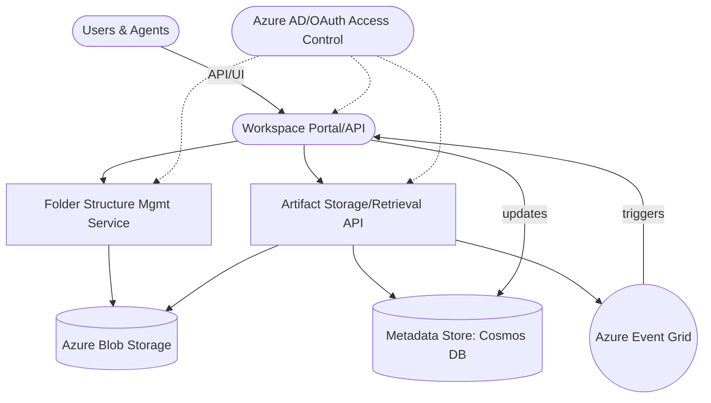

# Technical System Design (TSD)

## 1. Introduction
This Technical System Design (TSD) defines the technical architecture and implementation approach for a multi-agent collaborative workspace designed to support robust artifact management, traceability, and access control as specified in the upstream Business Requirements Document (BRD).

**Business Requirement Source:** [BA-dynamic-agent/BRD.md]

## 2. System Goals and Scope
The system will deliver a collaborative workspace that enables:  
- Clear artifact generation, referencing, and storage across distinct agent folders  
- Robust artifact traceability  
- Consistent versioning and auditability  
- Controlled access for read/write operations

**In Scope:** Workspace file/folder architecture, artifact tracking mechanisms, access controls, and APIs for artifact operations.  
**Out of Scope:** Implementation of domain features outside artifact management; UI/UX design; execution logic of non-artifact agents.

## 3. Architecture Overview
The system employs:
- A cloud-hosted logical workspace (Azure Files/Blob Storage)
- Microservices for artifact management (API-based)
- Event-driven triggers for workflow steps (Azure Event Grid)
- Centralized metadata tracking (Cosmos DB)

### Logical Architecture Diagram

## 4. Functional Components
### 4.1 Folder Structure Management
- Establishes per-agent subfolders using naming convention `<agent>/<artifact_name>.<ext>`
- Supports creation/update/delete operations tied to agent identity and workflow step
- Ensures all agents have read-access to relevant folders, write-access only to their own

### 4.2 Artifact Storage & Retrieval API
- CRUD endpoints for artifacts in Azure Blob Storage
- Versioning enforced on updates (immutable snapshots)
- Metadata enforced: agent, step, timestamp, BR reference
- Checks naming conventions and duplicate prevention

### 4.3 Metadata & Traceability
- Centralized Cosmos DB for artifact metadata
- Indexes by agent, workflow step, BR reference, timestamps
- All artifact operations create audit entries

### 4.4 Access Control
- Azure AD-based authentication for all API/services
- RBAC to restrict write operations to owning agent
- Read access for all agents to all artifacts

## 5. Non-Functional Requirements (NFRs)
- **Versioning:** All artifacts versioned (immutable blobs, version pointer in metadata DB)
- **Access Control:** All endpoints require Azure AD (OAuth2) authentication; RBAC enforced; no cross-agent writes
- **Naming Conventions:** `<agent>/<artifact_name>.<ext>`
- **Audit & Logging:** All artifact writes/reads logged; audit retained for 2 years
- **Availability:** Storage/API SLA ≥ 99.9%
- **Latency:** API p99 < 200ms for metadata ops, <800ms for artifact upload/download (≤10MB)
- **Scalability:** 100 concurrent agents, 100,000 artifacts, 1TB total storage in initial launch
- **Cost:** ≤ $2,000/month for storage/compute (Azure S1 tier)

## 6. Key Technology & Infrastructure Decisions
### Storage
- **Choice:** Azure Blob Storage (hot tier for primary, archive for historical)
- **Rationale:** Durable, scalable, native Azure integration, event trigger support

### Metadata/Database
- **Choice:** Azure Cosmos DB
- **Rationale:** Low-latency, scalable, NoSQL schema for flexible workflow metadata

### Access/API
- **APIs:** FastAPI (Python, async), OpenAPI 3.0+, full RBAC integration
- **Alternatives Considered:** REST-only (chosen for speed/clarity vs GraphQL complexity)
- **Authentication:** Azure AD, managed identities possible for automation

### Event/Workflow Integration
- **Events:** Azure Event Grid triggers on artifact writes/updates
- **Alternatives Considered:** Kafka (overkill for scale, Azure-native preferred)

## 7. Compliance & Traceability
- All artifacts reference BRD by file and version
- Metadata indexed for full audit chain: agent, BR, step, timestamp
- Periodic audit jobs check for compliance

## 8. Extensibility & Operations
- **Extensibility:** Pluggable metadata, support for future domain-specific artifact types
- **Backup/DR:** GRS (Geo-redundant) backup for Storage; Cosmos DB backup policy enabled
- **Monitoring:** Azure Monitor, Prometheus for FastAPI endpoints, OpenTelemetry traces
- **Automation:** CI/CD for all services via GitHub Actions, ARM/Bicep templates for IaC

## 9. Alignment with BRD
- Artifact location, referencing, traceability, and access control strictly map to BR-01 through BR-12
- All system metadata and audit enforce traceability chain to business requirements
- System architecture enforces folder and artifact conventions, read/write controls, and versioned auditing as specified

## 10. Appendix
### References
- BA-dynamic-agent/BRD.md, Azure official documentation (Blob Storage, Cosmos DB, Event Grid, FastAPI)

### Glossary
- **Artifact:** Any document or file produced in workflow
- **Agent:** Discrete processing/producing entity in multi-agent flow
- **Workspace:** The Azure-backed root storage containing all agent folders/artifacts
- **RBAC:** Role-Based Access Control (enforced by Azure AD)
- **BRD:** Business Requirements Document
