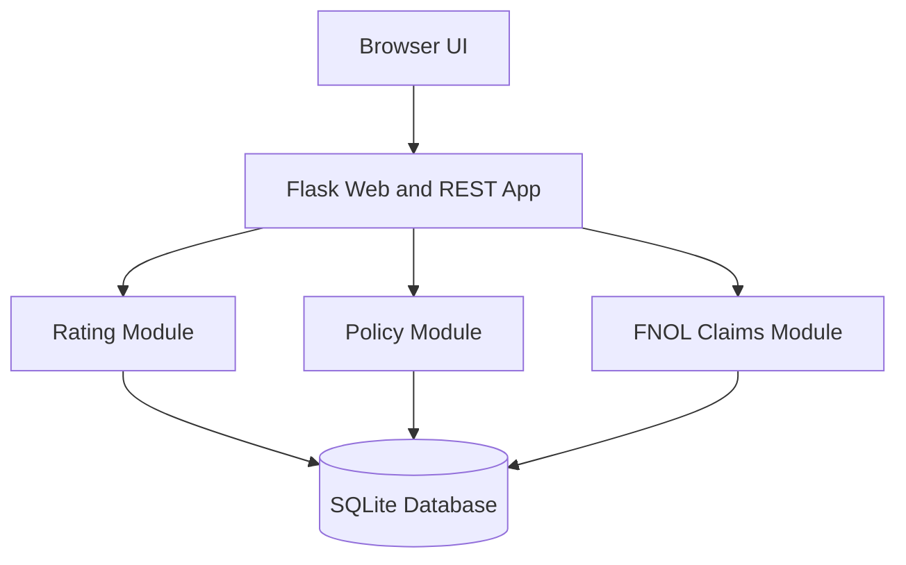
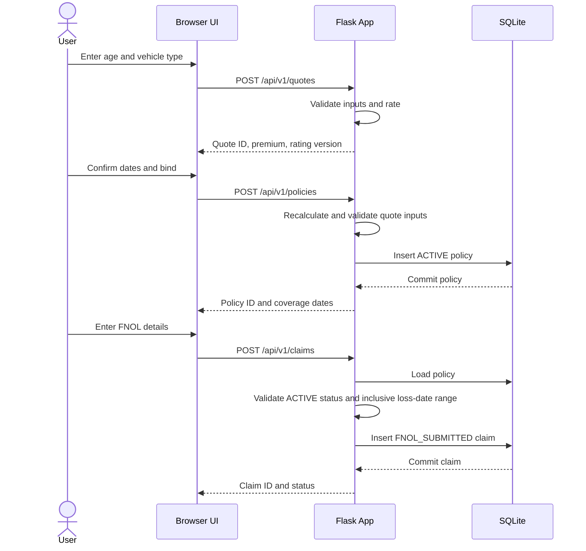
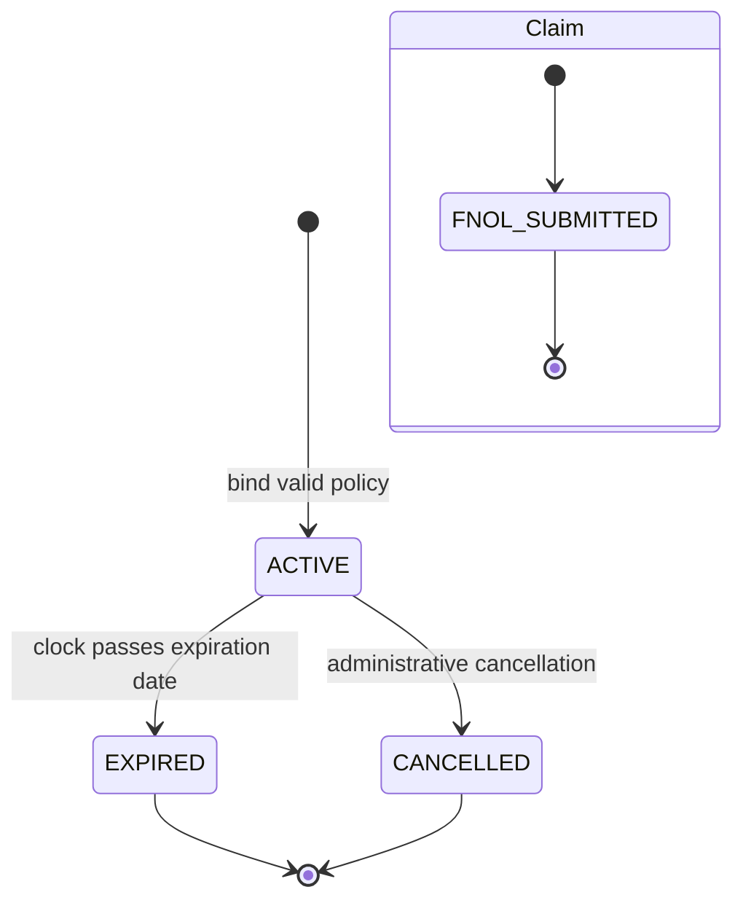
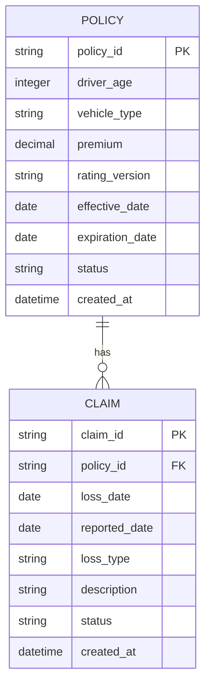

# Technical Specification Document
## Auto Insurance Quote & FNOL Claim App
**Date:** 2026-11-25  
**Version:** 1.0  
**Status:** MVP design

## 1. Document Approach

### 1.1 Project profile
- **Archetype:** self-contained transactional web application with a synchronous REST API and browser UI.
- **Primary capabilities:** deterministic quote rating, policy binding, FNOL registration, and claim-status lookup.
- **Persistence:** local relational storage for Policy and Claim records with referential integrity.
- **External integrations:** none in the MVP; the browser is the only client.
- **Security/compliance:** lightweight MVP controls; no real payment, identity, or sensitive identity-document data is processed.

### 1.2 Delivery mode and stack
This is **LITE mode**: three runtime concerns (browser UI, Flask application, SQLite database), no external integrations, and a deliberately small data model. The user suggested Flask + SQLite; this design selects Python 3.12, Flask 3.x, SQLite 3, SQLAlchemy 2.x, and pytest. HTML/CSS/vanilla JavaScript is served by Flask to keep the application self-contained.

### 1.3 Tailoring decisions
| Topic | Decision | Signal and rationale |
|---|---|---|
| Architecture | Included | Four transactional capabilities require component boundaries and flows. |
| Domain rules | Included | BR-01–BR-28 require rating, eligibility, date, and status rules. |
| Data design | Included | BR-10 and BR-22 require persistent Policy and Claim records. |
| REST contracts | Included | Browser-to-server operations need explicit request and error contracts. |
| Security | Included, MVP depth | BR-31 and BR-35 require safe validation and minimized personal data. |
| Event/messaging design | Omitted | No asynchronous requirement or broker is in scope. |
| External integrations | Omitted | BRD explicitly excludes payment, driver-record, identity, and claims integrations. |
| Production cloud topology | Omitted from MVP, local deployment specified | The request asks for a self-contained local app, not a production hosting build. |
| Full test plan | Omitted | Testing is an implementation-team concern; this TSD defines testable acceptance surfaces and required verification targets. |

## 2. Scope, Assumptions, and Key Decisions

### 2.1 In scope
The application validates driver age and vehicle type, calculates an indicative premium, binds a valid policy, accepts a basic FNOL against an eligible policy, and retrieves claim status. It stores only the fields required by the BRD.

### 2.2 Out of scope
Payments, authentication federation, identity verification, external data enrichment, endorsements, renewals, cancellation, multi-vehicle policies, evidence uploads, adjudication, settlement, adjuster assignment, fraud scoring, and deductible calculation are excluded from this release.

### 2.3 Explicit MVP assumptions
| ID | Assumption |
|---|---|
| A-01 | Minimum eligible driver age is 18; ages below 18 are rejected with `UNDERAGE_DRIVER`. |
| A-02 | Supported vehicle types are `sedan`, `suv`, `truck`, and `motorcycle`. |
| A-03 | Currency is USD and premium values are rounded to two decimal places using half-up rounding. |
| A-04 | Effective and expiration dates are inclusive; a loss on either boundary is covered when the policy is active. |
| A-05 | Policy term defaults to 365 calendar days from the effective date; the bind request may supply explicit dates. |
| A-06 | Policy status values are `ACTIVE`, `EXPIRED`, and `CANCELLED`; only `ACTIVE` policies are claim-eligible. |
| A-07 | New claims start in `FNOL_SUBMITTED`; claim-status lookup is read-only. |
| A-08 | Reported date is generated by the server in UTC; future loss dates are rejected. |
| A-09 | The illustrative rating schedule below is approved for MVP demonstration and is versioned as `rating-v1`. |

### 2.4 Major decisions and trade-offs
| Decision | Choice | Rationale and trade-off |
|---|---|---|
| Application shape | Modular monolith | Lowest operational complexity and easy local execution; less independent scaling than microservices. |
| Web framework | Flask | Small, familiar Python surface and straightforward HTML/API serving; fewer built-in conventions than FastAPI. |
| Database | SQLite in WAL mode | Zero external dependency and ACID transactions for a demo; unsuitable for high-concurrency production workloads. |
| API style | JSON REST under `/api/v1` | Simple browser integration and explicit contracts; no event-driven extensibility in MVP. |
| IDs | UUID strings | Avoids sequential identifier disclosure and works across future storage migration; slightly larger indexes. |

## 3. Architecture and Runtime Flows

### 3.1 Logical architecture



The Flask process owns HTTP routing, request validation, application services, and persistence orchestration. The rating module is a pure function with no database dependency. Policy and claims modules use SQLAlchemy repositories and a single transaction per write. The UI calls only versioned API endpoints and does not implement authoritative business rules.

### 3.2 Component responsibilities
| Component | Responsibility | Transaction boundary |
|---|---|---|
| Browser UI | Collect inputs, render quote/policy/claim results, show validation messages | None |
| Flask API | Parse JSON, enforce content limits, map domain outcomes to HTTP responses | Per request |
| Rating module | Validate rating inputs and compute `rating-v1` premium | Pure computation |
| Policy module | Validate quote eligibility and dates; create policy | One database transaction |
| FNOL module | Load policy, validate claim eligibility and loss date, create claim | One database transaction |
| SQLite | Durable local records, uniqueness, foreign-key enforcement, indexes | ACID |

### 3.3 Quote, bind, and FNOL flow


### 3.4 Failure behavior
Invalid JSON, missing fields, unsupported enum values, underage drivers, unknown policies, inactive policies, invalid date ranges, and out-of-period losses return a structured 4xx response. No policy or claim row is committed after a validation failure. Database failures return a generic 500 response and are logged with a correlation ID; raw SQL and stack traces are never returned.

## 4. Domain Rules and Rating Specification

### 4.1 Rating inputs and schedule
The API accepts integer `driver_age` and one supported `vehicle_type`. The following deterministic schedule is the MVP implementation of `rating-v1`:

| Rule | Formula |
|---|---:|
| Eligibility | `driver_age >= 18` |
| Base by vehicle | sedan $900; suv $1,100; truck $1,200; motorcycle $800 |
| Age factor | 18–24: 1.50; 25–64: 1.00; 65+: 1.20 |
| Premium | `round_half_up(base * age_factor, 2)` |

Examples: a 22-year-old sedan is `$1,350.00`; a 40-year-old SUV is `$1,100.00`; a 70-year-old truck is `$1,440.00`. The rating service returns the factor inputs and version so the policy retains its rating basis.

### 4.2 Domain validation rules
| Code | Rule | Outcome |
|---|---|---|
| `INVALID_AGE` | Age must be an integer from 0 through 120 | Reject quote/bind with 422 |
| `UNDERAGE_DRIVER` | Age below 18 | Reject quote/bind with 422 |
| `INVALID_VEHICLE_TYPE` | Type is not one of four supported values | Reject quote/bind with 422 |
| `INVALID_POLICY_DATES` | Effective date is after or equal to expiration date | Reject bind with 422 |
| `POLICY_NOT_FOUND` | Policy ID does not exist | Reject claim with 404 |
| `POLICY_NOT_CLAIM_ELIGIBLE` | Status is not `ACTIVE` | Reject claim with 409 |
| `LOSS_DATE_OUTSIDE_COVERAGE` | Loss date is before effective or after expiration | Reject claim with 422 |
| `FUTURE_LOSS_DATE` | Loss date is after current UTC date | Reject claim with 422 |
| `INVALID_FNOL` | Missing/blank loss type or description, or description over 2,000 characters | Reject claim with 422 |

### 4.3 Policy and claim lifecycle


The application computes an expired policy status at read or claim-validation time when `today > expiration_date`; it may persist the transition in a maintenance operation. A policy with loss date on the expiration boundary remains eligible under A-04. Claim lifecycle expansion is intentionally deferred.

## 5. Data Design

### 5.1 Relational model



### 5.2 Schema and indexes
| Table | Column | Type/constraint |
|---|---|---|
| `policies` | `policy_id` | `CHAR(36)` primary key |
|  | `driver_age` | integer, not null, 0–120 check |
|  | `vehicle_type` | varchar(20), not null |
|  | `premium` | decimal(10,2), not null, >= 0 |
|  | `rating_version` | varchar(20), not null |
|  | `effective_date`, `expiration_date` | date, not null; effective < expiration |
|  | `status` | varchar(12), not null |
|  | `created_at` | UTC datetime, not null |
| `claims` | `claim_id` | `CHAR(36)` primary key |
|  | `policy_id` | `CHAR(36)` foreign key to policies, not null |
|  | `loss_date`, `reported_date` | date, not null |
|  | `loss_type` | varchar(50), not null |
|  | `description` | varchar(2000), not null |
|  | `status` | varchar(20), not null |
|  | `created_at` | UTC datetime, not null |

Indexes: `claims(policy_id)`, `claims(status)`, `policies(status, expiration_date)`. SQLite foreign-key enforcement is enabled on every connection, and WAL mode is enabled for read concurrency. The MVP retains records indefinitely in local development; a production implementation must set a retention policy before real customer data is accepted.

### 5.3 Consistency and integrity
A policy bind recalculates the quote from submitted inputs rather than trusting a client premium. Claim submission locks the logical validation sequence in one transaction: load policy, derive effective status, validate dates, insert claim. A foreign key prevents orphan claims. Duplicate UUID collision is treated as a retryable server error and regenerated.

## 6. REST API Contracts

All endpoints use JSON, UTF-8, `/api/v1`, and `Content-Type: application/json`. Maximum request body size is 64 KiB.

| Method/path | Request | Success | Main errors |
|---|---|---|---|
| `POST /quotes` | `{driver_age, vehicle_type}` | `201 {quote_id, premium, currency, rating_version, inputs}` | 422 validation |
| `POST /policies` | `{driver_age, vehicle_type, effective_date, expiration_date}` | `201 {policy_id, premium, status, coverage}` | 422 validation |
| `POST /claims` | `{policy_id, loss_date, loss_type, description}` | `201 {claim_id, policy_id, status, loss_date, reported_date}` | 404 policy; 409 inactive; 422 date/input |
| `GET /claims/{claim_id}` | none | `200 {claim_id, policy_id, loss_date, reported_date, loss_type, description, status}` | 404 not found |
| `GET /policies/{policy_id}` | none | `200 policy representation` | 404 not found |

The quote identifier is an opaque short-lived reference for the UI and does not need to be persisted; bind requests remain safe because rating is recalculated. If quote persistence is added later, it must include an expiry of 30 minutes and a rating-version field.

### 6.1 Error contract
```json
{
  "error": {
    "code": "LOSS_DATE_OUTSIDE_COVERAGE",
    "message": "Loss date must fall within the policy coverage period.",
    "correlation_id": "8f3c3e8c-4e08-4d89-a7a0-4ad8e7c2a5d3",
    "field": "loss_date"
  }
}
```

Messages are user-safe and stable by code. Validation returns 422, missing resources 404, inactive policy conflicts 409, malformed JSON 400, unsupported method/media type 405/415, and unexpected failures 500.

## 7. Security, Privacy, and Observability

### 7.1 Security controls
- MVP runs on `127.0.0.1` by default and must use HTTPS behind any shared or hosted reverse proxy.
- No passwords, payment credentials, government identifiers, or driver-license data are collected.
- Apply strict JSON parsing, field allow-lists, type/range checks, length limits, parameterized SQLAlchemy queries, and HTML escaping in the UI.
- Generate a correlation ID per request; do not log full descriptions if they contain potentially sensitive information.
- Use Flask secret configuration from environment variables, never source control. Disable debug mode outside development.
- Add authentication and policyholder/operator authorization before deployment beyond local demonstration; production default should be deny-by-default with claim access restricted to the authenticated policyholder or claims operator.
- Use security headers (`Content-Security-Policy`, `X-Content-Type-Options`, `Referrer-Policy`) and CSRF protection if cookie-backed sessions are introduced.

### 7.2 Observability
Structured logs include correlation ID, route, status code, latency, and error code; they exclude descriptions and raw request bodies. Metrics include request count, 4xx/5xx rate, quote latency, bind count, FNOL acceptance/rejection count, and SQLite errors. Local health endpoint `GET /healthz` returns process and database connectivity without business data. Target alert thresholds: 5xx >1% over 5 minutes, p95 latency >500 ms over 10 minutes, or database error count >5 in 5 minutes.

## 8. Local Deployment and Engineering Verification

### 8.1 Repository layout
```text
app/
  __init__.py
  models.py
  rating.py
  policies.py
  claims.py
  api.py
  templates/index.html
  static/app.js
run.py
requirements.txt
pytest.ini
tests/
  test_rating.py
  test_validation.py
```

### 8.2 Local run procedure
1. Install Python 3.12 and create an isolated environment: `python -m venv .venv`.
2. Activate it (`.venv\\Scripts\\activate` on Windows or `source .venv/bin/activate` on macOS/Linux).
3. Install pinned dependencies with `pip install -r requirements.txt`.
4. Set `FLASK_ENV=development` and `DATABASE_URL=sqlite:///insurance.db`.
5. Start with `flask --app run.py run --debug`.
6. Open `http://127.0.0.1:5000`; the app creates the SQLite schema on first start.
7. Run verification with `pytest -q`.

The development server is not a production server. A hosted deployment should use a WSGI server such as Gunicorn behind a TLS reverse proxy and replace SQLite with PostgreSQL after concurrency and backup requirements are approved.

### 8.3 Required automated verification surface
The implementation must include at least these five automated checks:

| Test | Expected result |
|---|---|
| 22-year-old sedan | Premium equals `$1,350.00` (base 900 × 1.50). |
| 40-year-old SUV | Premium equals `$1,100.00` (base 1,100 × 1.00). |
| 70-year-old truck | Premium equals `$1,440.00` (base 1,200 × 1.20). |
| Claim loss date before effective date | HTTP 422 with `LOSS_DATE_OUTSIDE_COVERAGE`; no claim row. |
| Claim against expired/inactive policy | HTTP 409 with `POLICY_NOT_CLAIM_ELIGIBLE`; no claim row. |

Additional boundary tests should cover age 18, age 17, supported-type rejection, loss on both coverage boundaries, malformed dates, unknown claim ID, duplicate submissions, and database rollback. The rating tests must call the pure rating function directly; API validation tests must use an isolated temporary SQLite database.

## 9. Quantified Non-Functional Targets

| Attribute | MVP target | Design mechanism and verification |
|---|---:|---|
| Quote latency | p95 < 100 ms for 1–10 concurrent local clients | Pure in-process rating; measure with pytest/performance script. |
| Policy/FNOL latency | p95 < 250 ms for 1–10 concurrent local clients | Single indexed SQLite transaction; measure endpoint timings. |
| Throughput | >= 20 requests/second sustained for 60 seconds locally | WAL mode, small records; load test before claiming suitability. |
| Availability | >= 99.0% during a controlled 8-hour demonstration window | Process supervisor/manual restart and `/healthz`; production target must be re-baselined. |
| Data durability | RPO <= 24 hours; RTO <= 4 hours for local MVP | Daily copy of `insurance.db` while stopped or checkpointed; documented restore. |
| Data integrity | 0 orphan claims and 0 committed invalid policies/claims in test suite | FK enforcement, transaction boundaries, validation tests. |
| Security | 0 high/critical findings in dependency scan; request body <=64 KiB | Pinned dependencies, allow-list validation, secure headers, CI scan. |
| Cost | <$10/month for local MVP operating cost | Runs on developer workstation; excludes staff time and future hosting. |

These are engineering acceptance targets for the self-contained MVP, not production insurance-platform SLAs.

## 10. Requirements Traceability

| BRD requirement(s) | TSD design element |
|---|---|
| BR-01–BR-07 | §4 rating inputs, schedule, and validation codes; §6 quote endpoint |
| BR-08–BR-14 | §4 policy rules; §5 policy schema; `POST /policies` |
| BR-15–BR-24 | §3.3 FNOL flow; §4 validation; §5 claim schema; `POST /claims` |
| BR-25–BR-28 | `GET /claims/{claim_id}` and §6.1 error contract |
| BR-29–BR-30 | Pure deterministic rating, server-side recalculation, ACID transactions |
| BR-31 | Stable safe error codes/messages in §6.1 |
| BR-32 | SQLite foreign key and transaction design in §5.3 |
| BR-33 | Flask-served browser UI and local run instructions in §8 |
| BR-34 | Required five automated checks in §8.3 |
| BR-35 | Data minimization and logging controls in §7 |
| BR-36 | Explicit policy and claim status values in §4.3 and §5 |

## 11. Risks, Future Evolution, and Acceptance Gate

| Risk | Impact | Mitigation |
|---|---|---|
| Demonstration rating schedule differs from insurer-approved rates | Incorrect premium decisions | Version the schedule; replace constants only through reviewed configuration and regression tests. |
| SQLite concurrency or corruption under shared use | Failed writes or unavailable app | Restrict MVP to local use; migrate to PostgreSQL and managed backups before multi-user deployment. |
| No authentication | Unauthorized policy/claim lookup if exposed | Bind to localhost; require OIDC/session authorization before network exposure. |
| Ambiguous jurisdictional rules | Non-compliant age or coverage behavior | Obtain legal/product approval for minimum age, dates, currency, and retention before production. |
| Free-text loss description may contain PII | Privacy exposure in logs or exports | Limit length, escape output, redact logs, and add privacy review. |

Two planned P&C enhancements are: **deductible calculation**, adding coverage/deductible configuration and exposing net estimated loss; and **fraud scoring**, adding an explainable risk score from claim timing, frequency, and consistency signals with human review rather than automatic denial. Both require new data governance, audit, security, and model-validation decisions.

The MVP acceptance gate is: all four API journeys work end-to-end; the five required checks pass; invalid age, unsupported vehicle, invalid policy dates, unknown policy, expired policy, and out-of-coverage loss date are rejected without writes; policy-to-claim foreign keys remain valid; and local restore is demonstrated within four hours.

## 12. Glossary

- **Auto insurance:** A property-and-casualty insurance line that protects against defined vehicle-related risks, such as collision, theft, or liability. This MVP models only the quote, policy, and initial claim-registration stages; it does not determine coverage or settle losses.
- **Claim:** A reported request for insurance handling following a loss event. In this MVP, a claim is created only after the referenced policy, policy status, required FNOL fields, and loss date pass validation.
- **Claim status:** The current processing state of a claim. The MVP initializes accepted claims as `FNOL_SUBMITTED`; later states such as review, adjustment, settlement, or closure are outside the initial lifecycle.
- **Coverage period:** The inclusive calendar-date interval during which a policy is eligible to respond to a covered loss, beginning on `effective_date` and ending on `expiration_date`. Under assumption A-04, losses on both boundary dates are included.
- **Effective date:** The date on which a bound policy begins providing coverage according to the policy record.
- **Expiration date:** The final date of the policy coverage period. A loss after this date fails coverage-date validation, and a policy is treated as expired when the current date is later than this value.
- **FNOL:** First Notice of Loss, the initial report of an incident to an insurer. The MVP captures the policy reference, loss date, loss type, description, server-generated report date, and initial claim status; it does not perform adjudication.
- **Indicative premium:** The calculated price estimate returned by the rating service before any out-of-scope payment or full underwriting process. The MVP premium is deterministic and based only on driver age and vehicle type.
- **Policy:** The contractual insurance record created when a valid quote input is bound. The MVP policy stores the rating inputs, premium, rating version, coverage dates, status, and identifiers required to associate later claims.
- **Policy bind / binding:** The transaction that converts eligible quote inputs into an `ACTIVE` policy after server-side rating recalculation and date validation. Binding does not represent payment collection in this MVP.
- **Policy status:** The lifecycle value describing whether a policy can be used for claim registration. Valid MVP values are `ACTIVE`, `EXPIRED`, and `CANCELLED`; only `ACTIVE` policies are claim-eligible.
- **Rating factor:** A numeric multiplier applied to a base vehicle premium to represent an approved pricing characteristic. This MVP uses age-band factors of 1.50, 1.00, and 1.20.
- **Rating version:** A stable identifier, currently `rating-v1`, for the exact premium schedule and calculation rules used for a quote or bound policy. Persisting it supports auditability when rating rules change.
- **Vehicle type:** The normalized vehicle category supplied to the rating service. MVP values are `sedan`, `suv`, `truck`, and `motorcycle`, each with a defined base premium.
- **Loss date:** The calendar date on which the insured incident is asserted to have occurred. It must not be in the future and must fall within the policy's inclusive coverage period.
- **Reported date:** The UTC calendar date on which the application records the FNOL submission. It is generated by the server rather than trusted from the client.
- **Underage driver:** A driver below the configured minimum eligibility age. Under assumption A-01, this means a driver younger than 18 and results in the `UNDERAGE_DRIVER` validation error.
