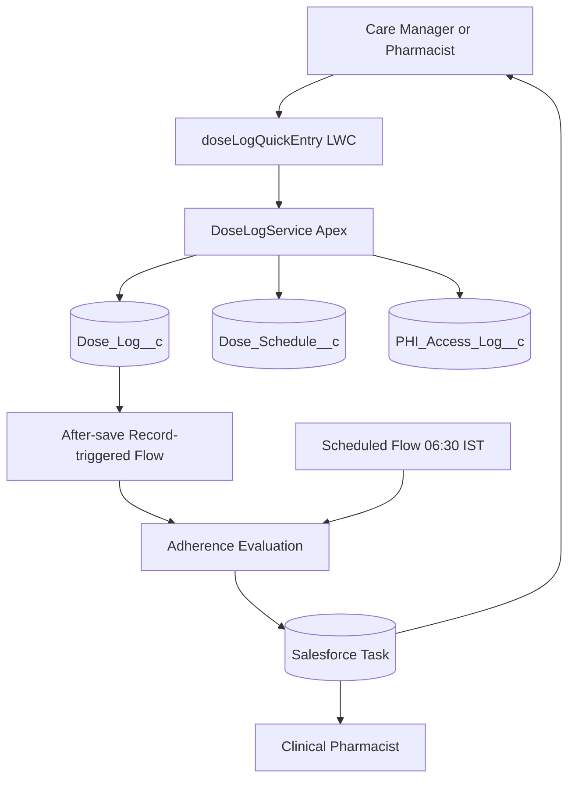
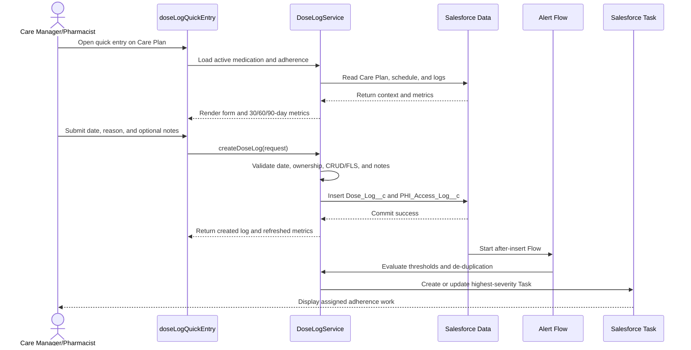
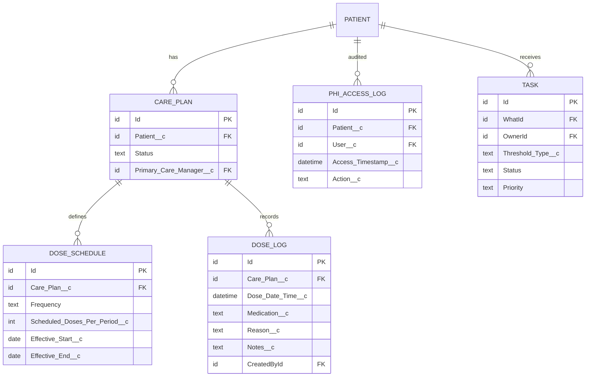

# Technical Specification Document
## CarePath Plus Missed Dose Logging & Adherence Alerts

**Date:** 2026-10-19  
**Version:** 1.0  
**Status:** Draft for implementation  
**Architecture Mode:** STANDARD  
**Platform:** Salesforce Health Cloud

## 1. Executive Summary

### 1.1 Purpose
This system introduces a structured missed-dose capture and adherence-alert capability for CarePath Plus oncology and autoimmune therapy cohorts. It replaces free-text Case notes and spreadsheet-based monthly calculations with a sub-15-second quick-entry experience on the Care Plan record, rolling 30/60/90-day adherence metrics, and controlled care-team Tasks.

The design reduces detection latency from 3–4 weeks to same-day evaluation, supports clinical escalation after consecutive missed doses or low adherence, and creates an auditable PHI access record for every dose-log insert.

### 1.2 Scope
**In scope:**
- Custom `doseLogQuickEntry` Lightning Web Component (LWC) on the Care Plan Lightning Record Page.
- Structured `Dose_Log__c` creation for the active Care Plan medication.
- Dose date/time, curated reason, optional 500-character notes, and server-side validation.
- On-demand 30-, 60-, and 90-day adherence calculation for one patient.
- After-insert threshold evaluation and de-duplicated Salesforce Task creation.
- Daily 06:30 IST scheduled re-evaluation for patients with a recent dose log.
- `PHI_Access_Log__c` audit entry for every dose-log insert.
- Role-based access, field security, validation, auditability, monitoring, and deployment controls.

**Out of scope:**
- Patient-facing SMS, WhatsApp, portal, or mobile reminders.
- Pharmacy dispense reconciliation.
- Hospitalization-driven adherence pause logic.
- Supervisor override UX; Phase 1 permits controlled administrator DML for post-24-hour corrections.
- Cross-widget adherence signals with Financial Assistance or Refill workstreams.

### 1.3 Key Decisions
1. **LWC on the Care Plan record page:** preserves the existing Health Cloud work surface and minimizes context switching; trade-off is Salesforce-specific UI implementation.
2. **Apex service for writes and calculations:** centralizes server-side validation, sharing, CRUD/FLS enforcement, and reusable rolling-window logic; avoids duplicating clinical rules in JavaScript and Flow.
3. **Record-triggered Flow for alert orchestration:** uses native Salesforce automation and supports Get Records-based de-duplication without an Apex trigger; trade-off is stricter Flow bulkification design.
4. **Scheduled Flow at 06:30 IST:** catches deterioration caused by stopped logging; scope is limited to patients with a `Dose_Log__c` in the preceding 45 days to control runtime.
5. **Curated reason picklist:** reduces ungoverned PHI leakage compared with free-text reasons; optional notes remain subject to quarterly PHI scrub review.

## 2. Context, Users, and Requirements

### 2.1 Users and Roles
| Role | Primary responsibility | Required access |
|---|---|---|
| Care manager | Log missed doses and act on adherence Tasks | Create/read Dose Logs for assigned patients; update own entries for 24 hours |
| Clinical pharmacist | Log doses and review critical adherence breaches | Create/read Dose Logs; receive high-severity clinical-review Tasks |
| Supervisor | Operational oversight | Read dose logs and tasks; Phase 1 correction via controlled admin process |
| Salesforce administrator | Configuration, support, and approved correction | Full object access with audited administrative actions |
| Clinical adherence lead | Program governance and reporting | Read adherence metrics and task outcomes |

### 2.2 Functional Requirements
| ID | Requirement | Acceptance measure |
|---|---|---|
| FR-01 | Open quick entry from the Care Plan record page in one click | Component is available as a record-page action and keyboard/tab accessible |
| FR-02 | Default dose date/time to current user-local time | Initial value is current time; user can back-date no more than 14 calendar days |
| FR-03 | Auto-populate medication from the active Care Plan | No manual medication picklist is presented |
| FR-04 | Capture curated reason | Values: Forgot, Side effects, Cost / access, Feeling better, Travel, Hospitalization, Other |
| FR-05 | Capture optional notes | Maximum 500 characters; character count and validation are visible |
| FR-06 | Calculate adherence | `(scheduled doses − missed doses) / scheduled doses × 100` for rolling 30/60/90-day windows |
| FR-07 | Evaluate thresholds after insert and daily | Highest-severity eligible threshold wins; duplicate controls are enforced |
| FR-08 | Audit every insert | One `PHI_Access_Log__c` record with user, patient, timestamp, and `DOSE_LOG_ENTRY` |
| FR-09 | Permit self-edit within 24 hours | Creator can edit own entry until 24 hours after creation; later edits are read-only in UI |
| FR-10 | Surface errors without data loss | Validation errors are actionable and no partial dose log is committed |

### 2.3 Clinical Alert Rules
| Priority | Rule | Task owner | Task priority |
|---|---|---|---|
| 1 | 30-day adherence <60% | Clinical pharmacist and primary care manager | High |
| 2 | ≥3 consecutive missed doses in 7 days | Primary care manager | High |
| 3 | 30-day adherence <80% | Primary care manager | Normal |

The evaluation uses the most severe breached rule. Only one adherence Task per patient per rolling 24-hour period may be created. If an open Task already exists for the same patient and threshold type, the system adds a comment/update to that Task rather than creating a duplicate.

### 2.4 Non-Functional Requirements
| Category | Target |
|---|---|
| Quick-entry interaction | Open-to-ready state ≤2 seconds at p95; successful submission ≤3 seconds at p95 |
| Adherence calculation | Single-patient calculation ≤2 seconds at p95 for 90 days of data |
| Alert evaluation | Post-insert Flow starts within 60 seconds for 99% of records |
| Availability | 99.9% monthly availability during Salesforce service availability |
| Capacity | Support 4,200 active patients, 20,000 Dose Logs/month, and 100 concurrent users |
| Data integrity | 100% of committed Dose_Log__c inserts have a corresponding audit record |
| Accessibility | WCAG 2.1 AA-aligned keyboard navigation, labels, focus order, and error messaging |
| Security | 0 critical/high unresolved findings at production release; CRUD/FLS enforced server-side |
| Recovery | Salesforce platform recovery; operational recovery runbook tested quarterly with RTO ≤4 hours and RPO ≤15 minutes for configuration/data export artifacts |
| Cost | Stay within existing Salesforce licensing and Flow/Apex governor limits; no new paid external runtime in Phase 1 |

## 3. System Architecture

### 3.1 Logical Architecture

The diagram renderer was unavailable during generation; the following valid Mermaid source is retained for implementation review.



### 3.2 Component Responsibilities
| Component | Responsibility |
|---|---|
| `doseLogQuickEntry` | Render active medication, capture fields, validate user input for usability, invoke Apex, refresh metrics, expose accessible errors |
| `DoseLogService` | Enforce sharing, CRUD/FLS, date/edit rules, active Care Plan lookup, transactional Dose Log + audit write, adherence calculation |
| `Dose_Log__c` | System of record for structured missed-dose entries |
| `Dose_Schedule__c` | Existing source for scheduled dose derivation |
| After-save Flow | Start threshold evaluation after a committed Dose Log; call invocable Apex or subflow for calculation and task de-duplication |
| Scheduled Flow | At 06:30 IST daily, select qualifying patients and re-evaluate 30-day adherence/consecutive misses |
| Salesforce Task | Actionable work item linked to the patient Case and assigned by threshold severity |
| `PHI_Access_Log__c` | Immutable audit trail for dose-log access/write action |

### 3.3 Architectural Constraints
- All writes are executed in the user transaction through Apex with `with sharing` and explicit CRUD/FLS checks.
- The LWC never trusts client-side date or authorization checks.
- Alert automation must be bulk-safe for Salesforce Flow batch execution and must not perform unbounded queries or DML inside loops.
- Patient context is derived from the Care Plan and related Case; medication cannot be supplied as arbitrary client input.

## 4. System Flows

### 4.1 Primary Missed-Dose Entry Flow



### 4.2 Rendering and Calculation
1. LWC receives the Care Plan record ID from the Lightning record page.
2. Apex verifies the Care Plan is active, resolves the patient, and finds the active medication.
3. Apex reads applicable `Dose_Schedule__c` records and generates scheduled-dose counts for 30, 60, and 90 days using effective dates and frequency.
4. Apex reads `Dose_Log__c` records for the same Care Plan and counts missed doses by dose date/time; duplicate records for the same user-entered dose timestamp are rejected using a deterministic duplicate check.
5. Apex returns percentages rounded to one decimal place and a zero-scheduled-dose state when no schedule applies.

### 4.3 Alert Evaluation and De-duplication
1. After insertion, the Flow receives the new Dose Log and identifies the patient/Care Plan.
2. It evaluates 30-day adherence, 7-day consecutive misses, and 30-day <60% severity.
3. It selects the highest severity breached threshold.
4. It queries open adherence Tasks for the patient and threshold type.
5. If an open matching Task exists, it appends a timestamped evaluation comment and leaves one open Task.
6. Otherwise, it checks whether any adherence Task for that patient was created in the prior 24 hours. If yes, it updates the existing Task only when the new breach is more severe; if no, it creates a new Task.
7. Task subject includes patient, threshold type, and evaluation date; the description includes the calculated window, numerator/denominator, triggering Dose Log ID, and next action.

### 4.4 Scheduled Deterioration Check
The scheduled Flow runs at 06:30 IST daily and processes patients with at least one Dose Log created or having a dose date in the prior 45 days. It evaluates only the 30-day adherence and 7-day consecutive-miss rules, applies the same de-duplication, and records a run summary. A batch size of 200 patients keeps synchronous work below platform limits; failures are captured in a fault path and surfaced to the Salesforce administrator.

### 4.5 Error and Retry Handling
- Validation failures return a typed user-facing error and do not write either business or audit data.
- Transient Salesforce locking errors are retried by Flow once after a 5-minute scheduled path; a second failure creates an administrator error Task without exposing PHI in the error text.
- Duplicate-submission errors return the existing Dose Log reference where safe and instruct the user to refresh.
- Flow fault paths log flow name, record ID, error type, and correlation ID in the platform error log; PHI values are excluded.
- If audit insertion fails, the Dose Log transaction is rolled back so the 100% auditability requirement is preserved.

## 5. Data Architecture

### 5.1 Entity Model



### 5.2 Data Fields and Validation
| Object/field | Type | Rule |
|---|---|---|
| `Dose_Log__c.Care_Plan__c` | Lookup | Required; must reference an active Care Plan visible to the user |
| `Dose_Log__c.Patient__c` | Lookup | Server-derived from Care Plan; not client-writable |
| `Dose_Log__c.Medication__c` | Text/lookup aligned to existing schema | Server-derived from active Care Plan medication |
| `Dose_Log__c.Dose_Date_Time__c` | DateTime | Required; not future; no earlier than current date/time minus 14 calendar days |
| `Dose_Log__c.Reason__c` | Picklist | Required; exact curated values only |
| `Dose_Log__c.Notes__c` | Long text | Optional; maximum 500 characters; quarterly PHI scrub |
| `PHI_Access_Log__c.Action__c` | Picklist/text | Must equal `DOSE_LOG_ENTRY` for this transaction |
| `Task.Threshold_Type__c` | Controlled value | `ADHERENCE_LT_80`, `CONSECUTIVE_3_IN_7`, or `ADHERENCE_LT_60` |

### 5.3 Storage and Retention
| Data | System of record | Retention/control |
|---|---|---|
| Missed-dose entries | Salesforce `Dose_Log__c` | Retain according to CarePath Plus clinical-record policy; Phase 1 export and restore tested quarterly |
| Care schedules | Salesforce `Dose_Schedule__c` | Existing Care Plan retention policy |
| Audit events | `PHI_Access_Log__c` | Immutable to standard users; retain at least 7 years or the governing clinical-record period, whichever is longer |
| Adherence Tasks | Salesforce Task | Retain per operational case policy; closed tasks retained for reporting |

### 5.4 Consistency and Transaction Boundaries
The Dose Log and PHI audit record are committed in one Apex transaction. Adherence metrics are computed from committed records and are not persisted as a source of truth in Phase 1. Tasks are eventually consistent with the Dose Log and should appear within 60 seconds of commit. This avoids stale rollup data and removes batch-wide recalculation cost.

## 6. Technology and Integration Specification

### 6.1 Technology Stack
| Component | Technology | Purpose | Rationale and trade-off |
|---|---|---|---|
| User interface | Salesforce LWC, Lightning Design System | Fast accessible entry on Care Plan | Native Health Cloud context and no external hosting; coupled to Salesforce UI runtime |
| Service layer | Apex `DoseLogService` | Secure writes and calculations | Transactional Salesforce access and governor-limit visibility; more platform-specific than an external API |
| Automation | Record-triggered and scheduled Salesforce Flow | Alert orchestration and daily re-evaluation | Low-code maintainability and native Task integration; complex logic must remain bulk-safe |
| Data | Salesforce custom objects | Dose logs, schedules, audit | Reuses system of record and sharing model; reporting scale is bounded by platform limits |
| Audit | Existing `PHI_Access_Log__c` pattern | PHI access/write trace | Consistent with Patient Self-Enrollment TDD and Benefit Summary widget controls |
| Delivery | Salesforce DX, GitHub Actions, Salesforce CLI | Versioned deployment | Repeatable metadata promotion and pull-request review; requires org authentication governance |
| Monitoring | Salesforce debug/error logs, Flow error emails, custom admin dashboard | Operational visibility | Native and low cost; detailed distributed tracing is limited compared with external APM |

### 6.2 Apex Service Contract
The public service exposes two `@AuraEnabled` methods. Both return DTOs rather than raw sObjects.

```text
getAdherenceContext(carePlanId: Id) -> AdherenceContext
createDoseLog(request: DoseLogRequest) -> DoseLogResult
```

`AdherenceContext` contains `carePlanId`, `patientId`, `medicationLabel`, `window30`, `window60`, `window90`, `canEditExisting`, and `calculatedAt`. Each window contains `scheduledDoses`, `missedDoses`, `percentage`, and `status` (`CALCULATED`, `NO_SCHEDULE`, or `INSUFFICIENT_DATA`).

`DoseLogRequest` contains `carePlanId`, `doseDateTime`, `reason`, and `notes`. `patientId` and `medication` are deliberately omitted from the request and are resolved server-side.

### 6.3 Salesforce Integration Rules
- Use `with sharing` and `Security.stripInaccessible` or equivalent explicit CRUD/FLS checks before DML and before returning fields.
- Use a singleton/static request-scoped query service to avoid repeated SOQL for the same Care Plan.
- Query only the fields required by the calculation and UI.
- Bulkify invocable alert evaluation: one query for schedules, logs, and open Tasks per collection, followed by in-memory grouping.
- Do not perform callouts in the Dose Log transaction.
- Use Custom Metadata Types for threshold values, Task subjects, and timezone (`Asia/Kolkata`) so administrators can change configuration without code deployment while retaining audit through metadata deployment.

### 6.4 UI Behavior
- The component appears as a compact action/card with a single primary `Log missed dose` button.
- Focus moves to the first field on open and returns to the action on close.
- Date/time defaults to the current user-local time and displays the 14-day allowable range.
- Medication is displayed as read-only.
- Reason is required and has no free-text alternative.
- Notes displays a 500-character counter and strips unsupported control characters.
- On success, the form closes, a toast confirms creation, and the adherence metrics refresh.
- On failure, the component preserves entered values and announces an actionable error to a screen reader.

## 7. Deployment Architecture and Delivery

### 7.1 Environments
| Environment | Purpose | Data policy |
|---|---|---|
| Developer scratch orgs | Individual development | Synthetic data only |
| Integration sandbox | Apex, Flow, LWC, and metadata integration | Masked representative data |
| UAT sandbox | Six nominated care managers, three per hub | Masked data and scripted scenarios |
| Production | Live CarePath Plus operations | Clinical data with production controls |

### 7.2 Metadata Components
- `doseLogQuickEntry` LWC bundle.
- `DoseLogService` and unit-test classes.
- `Dose_Log__c` fields, validation rules, compact/list views, permissions, and page layout configuration.
- Record-triggered Flow on `Dose_Log__c` after insert.
- Daily scheduled Flow at 06:30 IST.
- Custom Metadata Types for thresholds and operational configuration.
- Permission sets for care managers, pharmacists, supervisors, and administrators.
- Reports/dashboard for adherence tasks, flow faults, audit completeness, and recent volume.

### 7.3 CI/CD Gates
1. Pull request requires Apex tests, LWC Jest tests, metadata validation, security review, and architecture approval.
2. Apex tests must achieve at least 85% aggregate coverage and 95% coverage for `DoseLogService` decision branches.
3. Salesforce CLI validates deployment against the integration sandbox before UAT promotion.
4. UAT promotion requires sign-off from the Clinical Adherence Lead, Clinical Pharmacist SME, and six nominated care managers.
5. Production deployment uses a Salesforce change set or CLI deployment in a 60-minute release window with a 30-minute smoke-test period.
6. Rollback is a versioned metadata deployment that disables the two Flows and removes the record-page action while preserving existing Dose Logs and audit records.

### 7.4 Capacity and Governor-Limit Controls
- Maximum synchronous request scope is one Care Plan and at most 90 days of relevant logs.
- Scheduled Flow processes 200 patients per batch and caps total daily work at 4,200 patients.
- Alert evaluation uses collection queries and one consolidated DML operation per object type.
- A daily admin dashboard reports Flow interviews, CPU time, SOQL rows, DML statements, unhandled faults, and alert volume.
- If a daily run exceeds 80% of the configured governor threshold for two consecutive days, administrators reduce batch size to 100 and investigate query selectivity before returning to 200.

## 8. Security, Privacy, and Compliance

### 8.1 Controls
| Layer | Control | Implementation |
|---|---|---|
| Identity | Least privilege | Permission sets and Health Cloud sharing rules; no profile-wide write access |
| Authorization | Record access | User must have access to the Care Plan/patient; Apex runs `with sharing` |
| Field security | CRUD/FLS | Server-side checks for all read/write fields; client controls are not security boundaries |
| Input validation | Clinical and privacy validation | Date window, future date, picklist allowlist, 500-character notes limit, active Care Plan check |
| Audit | PHI write trail | Transactional `PHI_Access_Log__c` record with user ID, patient ID, timestamp, action |
| Transport | Platform security | Salesforce-managed TLS; no external payload transport in Phase 1 |
| Logging | PHI minimization | Correlation IDs and object IDs only; no note text or patient names in diagnostic logs |
| Review | PHI hygiene | Quarterly scrub review of Notes, audit completeness, and unexpected free-text patterns |

### 8.2 Threat Mitigations
- Tampered Care Plan IDs are rejected when the user lacks record access or the Care Plan is inactive.
- Back-dating beyond 14 days is rejected both in LWC and Apex.
- Unauthorized edits after 24 hours are rejected by Apex regardless of UI state.
- Duplicate clicks are handled through server-side duplicate detection and transaction-safe error handling.
- Flow recursion is prevented by restricting the trigger to `after insert` and updating only Task records, never the Dose Log.
- PHI is not sent to external services, webhooks, or client-side analytics in Phase 1.

## 9. Performance, Capacity, and Cost

### 9.1 Capacity Model
The initial population is 4,200 active patients across two hubs. At 20,000 Dose Logs/month, average volume is approximately 667 logs/day, with a design peak of 2,000 logs/day and 100 simultaneous users. The service is sized for up to 50 relevant logs per patient per 90-day query and 200 scheduled-flow patients per batch.

### 9.2 Performance Targets
| Operation | p95 target | Measurement |
|---|---:|---|
| Open widget and load context | ≤2 seconds | Browser performance telemetry and UAT timing |
| Submit valid Dose Log | ≤3 seconds | Apex transaction timing and user telemetry |
| Calculate 30/60/90-day metrics | ≤2 seconds | Apex debug timing in load test |
| Create/update alert Task | ≤60 seconds after commit | Flow interview timestamp dashboard |
| Daily scheduled run | ≤30 minutes | Flow run summary |

### 9.3 Cost Model
Phase 1 uses existing Salesforce licenses and platform automation. Incremental infrastructure cost is **$0/month** outside existing Salesforce subscription and standard storage consumption. Delivery effort is budgeted at 5–7 engineer-weeks: Apex/service 2 weeks, LWC 1.5 weeks, Flow/configuration 1 week, security and testing 1.5–2.5 weeks. The primary trade-off is platform governor-limit complexity instead of introducing a separately hosted service.

## 10. Monitoring and Operations

### 10.1 Metrics and Dashboards
- Dose Logs created per hour/day by hub and role.
- Percentage of Dose Logs with a matching PHI audit record; target 100%.
- Widget load p50/p95 and submission p50/p95.
- Apex exceptions by validation category and unexpected category.
- Flow interviews, fault count, processing duration, and governor-limit utilization.
- Tasks created by threshold, duplicate updates, open age, and owner.
- Daily scheduled run coverage: eligible patients, evaluated patients, failures, and completion time.

### 10.2 Alerts and Runbooks
| Alert | Threshold | Severity | Action |
|---|---|---|---|
| Audit mismatch | Any committed Dose Log without audit record | Critical | Disable entry Flow path, inspect transaction, reconcile immediately |
| Flow faults | >5 faults in 15 minutes or >1% of daily interviews | High | Review fault IDs, retry eligible records, page Salesforce admin |
| Submission latency | p95 >3 seconds for 15 minutes | High | Inspect Apex limits and SOQL selectivity; reduce query scope if needed |
| Widget error rate | >2% for 15 minutes | High | Review permission/FLS and latest deployment; invoke rollback if widespread |
| Alert backlog | >100 eligible patients not evaluated by 08:00 IST | High | Restart scheduled run and process failed batch |
| Task noise | >10 adherence Tasks per manager per day for 3 days | Medium | Review de-duplication and threshold configuration with clinical lead |

### 10.3 Operational Procedures
- Salesforce administrators review the daily dashboard by 09:00 IST.
- Clinical operations review high-priority Task aging daily; Tasks older than 24 hours are escalated to the hub supervisor.
- Quarterly, the compliance owner samples 100 Dose Logs, verifies audit linkage, and reviews Notes for PHI leakage.
- Release rollback disables new automation but preserves historical Dose Logs, Tasks, and audit records.

## 11. Disaster Recovery and Data Protection

Salesforce platform backup/recovery remains the system-level recovery mechanism. The implementation team exports versioned metadata and weekly encrypted data extracts for `Dose_Log__c`, `PHI_Access_Log__c`, and configuration records to the organization-approved secure storage location.

| Scenario | RTO | RPO | Procedure |
|---|---:|---:|---|
| LWC deployment defect | 30 minutes | 0 | Deploy prior metadata version and disable entry action if required |
| Flow failure | 1 hour | 15 minutes | Disable faulty Flow, replay eligible logs through controlled admin run |
| Corrupt configuration | 4 hours | 24 hours | Restore Custom Metadata and permission-set versions from source control |
| Salesforce service outage | Per Salesforce service recovery | 0 for committed records | Follow Salesforce incident process; queue manual capture through approved downtime procedure |
| Data export loss | 4 hours | 7 days | Restore latest encrypted extract and reconcile with Salesforce audit trail |

## 12. Testing Strategy

- **Apex unit tests:** valid entry, each reason, future date, 14-day boundary, 15-day rejection, inactive Care Plan, missing schedule, no scheduled dose, 0%/60%/80% boundary calculations, duplicate entry, CRUD/FLS denial, audit rollback, and edit window.
- **Flow tests:** each threshold, severity precedence, same-threshold open Task update, 24-hour de-duplication, scheduled-flow selection, fault paths, and batch processing.
- **LWC Jest tests:** keyboard navigation, default date, read-only medication, character counter, validation messages, success refresh, server errors, and screen-reader announcements.
- **Integration tests:** end-to-end Care Plan action to Dose Log, audit record, metrics refresh, and Task creation in a sandbox.
- **Performance tests:** 100 concurrent widget opens, 50 concurrent submissions, 2,000 logs/day simulation, and scheduled run for 4,200 eligible patients.
- **Security tests:** permission-set matrix, record-sharing isolation, FLS, tampered IDs, injection/control characters, and PHI absence from logs.
- **UAT:** six care managers, three per hub, covering default, populated, back-date, error, threshold, and duplicate-task scenarios.

## 13. Implementation Roadmap

| Phase | Duration | Deliverables | Exit criteria |
|---|---:|---|---|
| 1. Schema confirmation | 3 business days | Confirm `Dose_Log__c`, `Dose_Schedule__c`, audit helper/event pattern, and picklist values | Technical Lead and Pharmacist SME sign-off |
| 2. Service and metadata | 7 business days | Apex service, fields, validation, permissions, audit transaction | Apex tests and security review pass |
| 3. LWC | 5 business days | Quick-entry states, accessibility, metrics, error handling | Keyboard and UX review pass |
| 4. Automation | 5 business days | After-insert and scheduled Flows, de-duplication, dashboards | Flow bulk and fault tests pass |
| 5. UAT and hardening | 7 business days | Six-user UAT, performance/security tests, defect fixes | UAT sign-off by 19 August 2026 target |
| 6. Production release | 2 business days | Deployment, smoke test, runbook, hypercare | Go-live aligned to end of Q3 FY26 release train |

## 14. Risks and Mitigations

| Risk | Impact | Probability | Mitigation |
|---|---|---|---|
| Existing object schema differs from meeting-note assumptions | High | Medium | Complete schema confirmation before build; use metadata-driven mappings |
| Flow governor limits during daily run | High | Medium | Batch at 200, collection queries, runtime dashboard, fallback batch size 100 |
| Free-text Notes contain PHI | High | Medium | Curated reason, 500-character cap, user guidance, quarterly PHI scrub |
| Task noise despite de-duplication | Medium | Medium | Highest-severity precedence, 24-hour cap, monitor per-manager volume |
| Care managers revert to free-text habit | High | Medium | ≤15-second UX target, six-user UAT, inline action from Case/Care Plan context |
| Medication schedule changes create calculation ambiguity | High | Medium | Effective-date schedule selection, explicit no-schedule state, clinical SME test cases |
| Salesforce release or permission regression | High | Low | Metadata versioning, deployment validation, permission matrix, rollback package |

## 15. Appendices

### 15.1 Glossary
- **Adherence:** Percentage of scheduled doses not missed in a rolling window.
- **Care Plan:** Health Cloud patient work surface containing the active medication and dose schedule.
- **Dose Log:** Structured record of a missed dose.
- **PHI:** Protected Health Information.
- **LWC:** Lightning Web Component.
- **Flow:** Salesforce declarative automation runtime.
- **RTO/RPO:** Recovery Time Objective/Recovery Point Objective.

### 15.2 Decision Traceability
| Meeting-note decision | TSD section |
|---|---|
| LWC on Care Plan record page | 1.3, 3.2, 6.4 |
| Apex insert and adherence calculation | 1.3, 3.2, 6.2 |
| After-insert Flow alerts | 2.3, 4.3, 7.2 |
| Daily 06:30 IST Flow | 4.4, 7.2 |
| PHI audit on every insert | 2.2, 5.4, 8.1 |
| 14-day back-date and 24-hour edit window | 2.2, 5.2, 8.2 |
| Phase 1 exclusions | 1.2 |

### 15.3 References
- CarePath Plus Meeting Notes — Missed Dose Logging & Adherence Alerts Discovery, 22 July 2026.
- Salesforce Health Cloud Care Plan and Lightning Record Page capabilities.
- Salesforce Apex security, Flow bulkification, Lightning Web Components accessibility, and platform governor-limit guidance.
