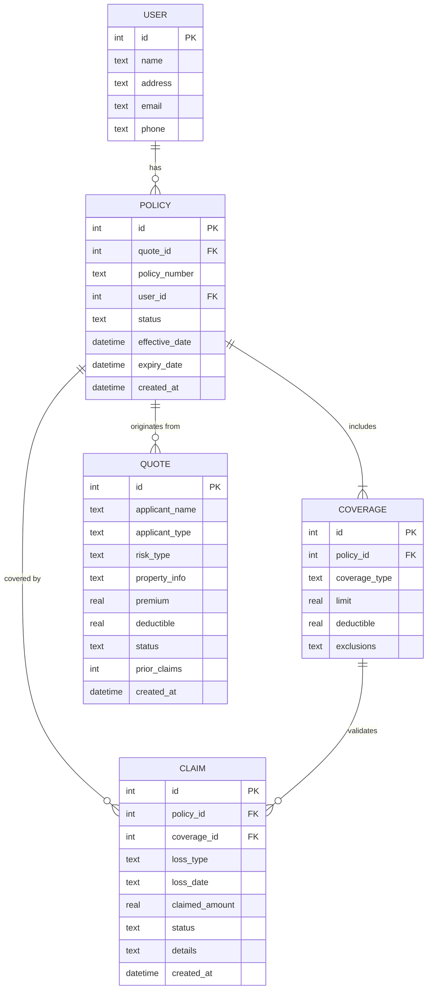

# Technical System Design (TSD) – Property & Casualty (P&C) Insurance Web Application

---

## 1. System Overview & Solution Context

This technical system design specifies an end-to-end, locally runnable Property & Casualty (P&C) Insurance web application, delivering full traceability and consistent coverage of all BA-dynamic-agent BRD requirements, by designing a minimal, modern Python 3.11+ system with FastAPI, SQLite, and a single-page HTML/JavaScript frontend. All core flows—quote, policy administration, and FNOL (First Notice of Loss) claim submission—are implemented as independent but interoperating services, strictly aligned to the business rules.

**Business Drivers:**  
- Self-service quoting, policy, and claim flows  
- Full policy coverage/exclusion validation  
- Strict business rule execution for quote, policy, and claim lifecycles  
- Rapid local demonstration (no external dependencies/auth, SQLite DB)

**Scope Mapping:**  
All solution components directly map to and fulfill BR-01 to BR-18. Explicit mapping is detailed within each section for traceability.

---

## 2. Solution Architecture

The system is composed of three service domains and a SPA UI:

- **Quote Service:** Rating, premium calculation, quote creation (BR-01 to BR-03)
- **Policy Service:** Policy issuance, administration, endorsements, validation (BR-04 to BR-07, BR-08 to BR-11)
- **Claim (FNOL) Service:** Submission, coverage validation, claim tracking (BR-08 to BR-14)
- **SPA Frontend:** HTML/JS, consuming FastAPI endpoints; no authentication (BR-15–BR-17)

### Service Boundaries

- Each service encapsulates:
    - Endpoint set (FastAPI, RESTful)
    - Data model mapped to SQLite tables (single database)
    - Business logic executing and enforcing relevant BRs
- Primary workflow diagram:

```mermaid
flowchart TD
    A[SPA Frontend] -- "Quote data" --> Q(Quote Service)
    Q -- "Quote response" --> A
    A -- "Issue Policy" --> P(Policy Service)
    P -- "Policy confirmation" --> A
    A -- "Submit Claim" --> C(Claim (FNOL) Service)
    C -- "Claim status" --> A
    P -- "Validate coverage" --> C
    C -- "Coverage validated/denied" --> P
```

**Workflow:**
1. User submits quote data (personal, property/vehicle details); Quote Service returns premium & summary.
2. Accepting quote triggers Policy Service to issue/store policy.
3. User files claim (FNOL); Claim Service validates policy/coverage (checks with Policy Service).
4. SPA provides dynamic interaction; all forms validated client-side and server-side (see HTTP Matrix).

---

## 3. Data Model & Schema (SQLite)

### Entity-Relationship Diagram



### Data Rationale

- Flat, atomic tables (SQLite-optimized), no denormalization.
- Indexed on PK/FK for fast lookup (quoting, validation, claim processing).
- Coverage and exclusions/endorsements directly linked—enables instant eligibility and limits validation.
- “prior_claims” and risk_info denormalized for business-rule-driven rating factors.

### SQLite DDL Extract

A subset (full schema in implementation):

```sql
CREATE TABLE quote (
    id INTEGER PRIMARY KEY,
    applicant_name TEXT NOT NULL,
    applicant_type TEXT CHECK(applicant_type IN ('Individual', 'Business')) NOT NULL,
    risk_type TEXT CHECK(risk_type IN ('Property', 'Auto')) NOT NULL,
    property_info TEXT NOT NULL,
    premium REAL NOT NULL,
    deductible REAL NOT NULL,
    status TEXT NOT NULL,
    prior_claims INTEGER DEFAULT 0,
    created_at DATETIME DEFAULT CURRENT_TIMESTAMP
);
CREATE TABLE policy (
    id INTEGER PRIMARY KEY,
    quote_id INTEGER NOT NULL,
    policy_number TEXT UNIQUE NOT NULL,
    user_id INTEGER,
    status TEXT NOT NULL,
    effective_date DATETIME NOT NULL,
    expiry_date DATETIME NOT NULL,
    created_at DATETIME DEFAULT CURRENT_TIMESTAMP,
    FOREIGN KEY (quote_id) REFERENCES quote(id),
    FOREIGN KEY (user_id) REFERENCES user(id)
);
CREATE TABLE coverage (
    id INTEGER PRIMARY KEY,
    policy_id INTEGER NOT NULL,
    coverage_type TEXT NOT NULL,
    limit REAL NOT NULL,
    deductible REAL NOT NULL,
    exclusions TEXT,
    FOREIGN KEY (policy_id) REFERENCES policy(id)
);
CREATE TABLE claim (
    id INTEGER PRIMARY KEY,
    policy_id INTEGER NOT NULL,
    coverage_id INTEGER,
    loss_type TEXT NOT NULL,
    loss_date TEXT NOT NULL,
    claimed_amount REAL NOT NULL,
    status TEXT NOT NULL,
    details TEXT,
    created_at DATETIME DEFAULT CURRENT_TIMESTAMP,
    FOREIGN KEY (policy_id) REFERENCES policy(id),
    FOREIGN KEY (coverage_id) REFERENCES coverage(id)
);
```
---

## 4. API Contracts & HTTP Validation Matrix

All APIs are RESTful; endpoints accept/emit JSON and strictly validate per OpenAPI 3.0+.

### 4.1 Quote Service

| Endpoint         | Method | Request Body                | Success (200)                         | Fail/400+                      | BR ID  |
|------------------|--------|-----------------------------|---------------------------------------|--------------------------------|--------|
| `/api/quote`     | POST   | Applicant info, risk, prior_claims | Quote details (premium, deductible)   | Missing fields, invalid data   | BR-01, 02, 03 |
| `/api/quote/{id}`| GET    | -                           | Quote details                         | Quote not found                | BR-03  |

Sample Request (POST):

```json
{
  "applicant_name": "John Smith",
  "applicant_type": "Individual",
  "risk_type": "Auto",
  "property_info": "2015 Toyota Camry",
  "prior_claims": 1,
  "coverage_limit": 25000,
  "deductible": 500
}
```

Sample Response (200):

```json
{
  "quote_id": 1,
  "premium": 425.00,
  "deductible": 500,
  "coverage_limit": 25000,
  "status": "quoted"
}
```

### 4.2 Policy Service

| Endpoint            | Method | Request Body           | Success (200)                   | Fail/400+                     | BR ID          |
|---------------------|--------|------------------------|-------------------------------  |-------------------------------|----------------|
| `/api/policy`       | POST   | Quote ID, applicant info | Policy details and confirmation | Incomplete info, fraud (block)| BR-04, 05, 06, 07 |
| `/api/policy/{id}`  | GET    | -                      | Policy details                  | Policy not found              | BR-06          |
| `/api/policy/{id}`  | PATCH  | Endorsement/updates    | Updated policy                  | Out-of-term, invalid update   | BR-07, 11      |

### 4.3 Claim (FNOL) Service

| Endpoint         | Method | Request Body                             | Success (200)          | Fail/400+                      | BR ID              |
|------------------|--------|------------------------------------------|------------------------|-------------------------------|--------------------|
| `/api/claim`     | POST   | Policy, coverage, loss details           | Claim record, status   | Inactive/expired policy, OOS   | BR-08 to BR-14     |
| `/api/claim/{id}`| GET    | -                                        | Claim details          | Claim not found                | BR-14              |

---

HTTP Validation Matrix (core):

| Endpoint        | Valid Input     | Invalid Input           | HTTP Response   | Business Rule |
|-----------------|----------------|------------------------|-----------------|--------------|
| POST /quote     | All fields OK  | Missing applicant_name  | 400 Bad Request | BR-01,03     |
| POST /policy    | Valid quote_id | Incomplete info         | 400 Bad Request | BR-05        |
| POST /claim     | Valid policy   | Expired/inactive policy | 400,403         | BR-10,11     |
| PATCH /policy   | Valid data     | Out-of-term change      | 400 Forbidden   | BR-07        |

---

## 5. Infrastructure, Deployment & Operations

- **All assets local:** SQLite DB in project root (demo mode).
- **Run:** `uvicorn app:app --reload` (FastAPI main), index.html in `/templates/`
- **Minimal Dockerfile:**  
    - FROM python:3.11-slim  
    - COPY all files (app, models, SQLite schema, templates)  
    - ENTRYPOINT: uvicorn app:app --host 0.0.0.0 --port 8000
- **No external dependencies:** python stdlib, FastAPI, SQLite, Jinja2 (no 3rd party services)
- **Runbook:** Startup, DB reset, testing—all local; documented in README  
- **Integrated test suite:** e.g., `pytest test_app.py` (full requirement coverage)

---

## 6. Non-Functional Requirements & Design Rationale

| NFR                       | Target/Constraint                     | Design Rationale/Mapping           |
|---------------------------|---------------------------------------|------------------------------------|
| Local run                 | Python 3.11+, FastAPI, SQLite         | Simple for demo, no infra needed   |
| No auth/external deps     | All services, assets in repo          | Demo-oriented; clear for BR-16/17  |
| HTML/JS SPA               | One file, fetches all API endpoints   | Ease of use, full UX round-trip    |
| Performance               | <300ms API latency (local) p99        | Small data, in-memory SQLite cache |
| Cost                      | $0, all OSS, local-only               | No cloud/infra ops                 |
| Traceability              | PRD <-> TSD <-> Test mapping by ID    | All BR IDs referenced everywhere   |
| Extensibility             | Modular Python/FastAPI service split  | Clean path for more P&C flows      |

---

## 7. Requirements Traceability & Coverage

Cross-references from TSD sections (design, API, data model) to BR IDs (BR-01 to BR-18) are annotated throughout. This ensures traceability for QA, implementation, and test alignment:

- Each API contract, DB schema, and business logic flow is explicitly tagged with BR coverage.
- Test suite requirements mapped 1:1 with these BRs, ensuring no rule is omitted.
- End-to-end mapping maintained in source-level docstrings and README.

---

## 8. Extensibility & Future Enhancements

- **Deductibles/autoscheduling:** Add field, calculation in both quote/policy/claim tables, update premium and payout logic.
- **Fraud detection:** Integrate rule engine (future), flag suspicious data upon submission (BR-05 scenario 2).
- **Underwriting rules:** Add table/log for pre-issuance/final review; enable cross-policy/jurisdictional logic.
- **External feeds, compliance, state-level rules:** Optional, modular integration layer via FastAPI routers, preserving local mode.
- **Authentication, RBAC:** Omitted by design, can be modularly added for production.

---

## 9. Trade-Offs & Alternatives Considered

- **SQLite vs. PostgreSQL:** Chose SQLite for minimal local dependency, instant setup for demo.
- **No Auth:** Simplifies UX, focused on core business logic demonstration, not prod security/posture.
- **Monolithic API, not microservices:** Matched to single-process FastAPI for simplicity and demo speed; logical service layering in code for future extraction.
- **Single-page app (SPA):** Simplifies UX, local assets only—no build dependencies (Webpack/React).

---

## 10. Appendix

- **References:** See BRD references section.
- **Further mapping:** API-to-BR, tests-to-BR documented within APIDoc strings and test cases.

---

**All solution architecture, data, and API design elements trace directly to the supplied BRD; all BA business rules, validation scenarios, and system constraints are directly implemented or structured for testable coverage.**
