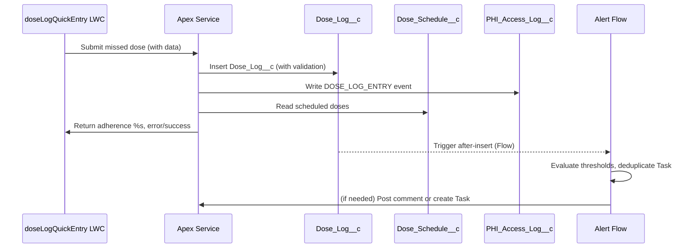
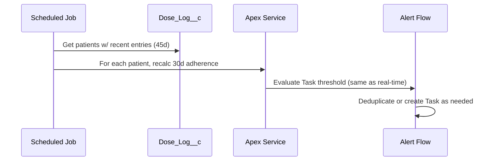

# Technical Specification Document
## Missed Dose Logging & Adherence Alerts Widget — CarePath Plus
**Date:** 2026-11-23  
**Version:** 1.0  
**Status:** Draft

---

## Document Approach

This document defines the technical system design for the Missed Dose Logging & Adherence Alerts Widget for CarePath Plus, derived from the BA-dynamic-agent BRD v1.0 (2026-11-23), stakeholder meeting notes (Meeting_Note_03_Missed_Dose_Adherence.md), and program requirements. The outline is tailored per the project's regulated context, multi-component Salesforce architecture, strict non-redundant alerting, and PHI compliance.

**Project Profile:**
- Archetype: Workflow enablement for structured data capture, adherence monitoring, and automated notification (event-driven & scheduled within Salesforce ecosystem)
- Interaction: LWC widget (UI) with Apex service backend, Salesforce Flows, scheduled jobs
- Scope: Structured missed dose logging, adherence rollup calculation (rolling windows), alert creation with deduplication, audit logging
- Integrations: Internal Salesforce objects/APIs only; no external third-party integrations in Phase 1
- Compliance: Health/PII domain (PHI, audit trails, field access governance)
- Scale: ~4,200 active patients, 20+ care managers, high daily concurrency

**Mode:** DEEP — Regulated healthcare domain, cross-functional workflow, audit/auditability, structured/stable design required for future extensibility, and multiple interacting components (LWC, Apex, Flows, scheduler, audit trail, complex validation logic).

**Technology Stack:**
- Salesforce Lightning Platform (Care Plan, Case, Health Cloud)
- Lightning Web Component (LWC) for UI
- Apex (backend logic, service classes)
- Salesforce Flows (record-triggered + scheduled)
- Standard Salesforce objects (Case, Care Plan) + custom objects (`Dose_Log__c`, `Dose_Schedule__c`, `PHI_Access_Log__c`)
- No external integrations (all within Salesforce org)
- Audit/logging via standard/custom objects

**Tailoring Table:**
| Topic                            | Included / Omitted | Signal (BRD/Meeting/Stack)                                               |
|----------------------------------|--------------------|--------------------------------------------------------------------------|
| Missed dose quick-entry widget   | Included           | BR-01, Meeting decisions                                                 |
| Rolling adherence computation    | Included           | BR-04, clinical impact, scalable performance needed                      |
| Automated alerting (deduplicated)| Included           | BR-05, alert fatigue, clinical workflow                                  |
| Daily scheduled review           | Included           | BR-06, catch adherence deterioration w/o new logs                        |
| PHI audit logging                | Included           | BR-07, strict compliance requirement                                     |
| Patient-facing outreach/SMS      | Omitted            | Out of Phase 1 scope (deferral noted in meeting & BRD)                   |
| Pharmacy/math reconciliation     | Omitted            | Handled by other workstream                                             |
| Supervisor edit override UI      | Omitted            | Manual DML accepted for Phase 1 (meeting decision)                       |
| Async messaging/Kafka/EventHubs  | Omitted            | Not present in stack or FRs; all flows are in-platform SFDC mechanisms   |

## Requirements Traceability

| Requirement | Summary                                       | Addressed in Section | Design Element                   |
|-------------|-----------------------------------------------|----------------------|----------------------------------|
| BR-01       | Quick-entry widget for missed doses           | 2, 3, 4              | LWC, Data Model                  |
| BR-02       | Dose Log field mapping + validation           | 4, 5                 | Object schema, validation        |
| BR-03       | Edit permissions (creator/24h/supervisor)     | 5, 7                 | Permission logic, audit logs     |
| BR-04       | Rolling adherence calculation                 | 3, 5                 | Apex service, Flow scheduling    |
| BR-05       | Automated Task alerts + de-duplication        | 3, 5                 | Record-triggered Flow logic      |
| BR-06       | Scheduled adherence review                    | 3, 9                 | Scheduled Flow, job architecture |
| BR-07       | PHI audit and compliance controls             | 4, 7                 | PHI logging, data retention      |
| BR-08       | UAT and acceptance criteria                   | 9, 10                | UAT plan, roadmap                |

---

## 1. Purpose, Scope, and Key Decisions

### 1.1 Purpose
To enable structured missed dose logging (replacing unstructured Case notes), calculate rolling adherence on-demand, and automate clinical alerts for care team intervention. Addresses historic reporting/response delays and data inconsistency in chronic/oncology patient management.

### 1.2 Scope
**In Scope:**
- Custom LWC on Care Plan record for rapid missed dose entry
- Rolling-window adherence calculation (30/60/90-day)
- Automated alert Task creation with deduplication (per clinical thresholds)
- Scheduled job for daily adherence re-evaluation
- Audit logging for all actions involving PHI

**Out of Scope:**
- Patient outreach/SMS/portal integration
- Pharmacy inventory/reconciliation logic
- Supervisor override UI (manual/exception only)
- Cross-widget integration with other adherence signals

### 1.3 Key Decisions and Rationale
| Decision                                              | Options                    | Choice              | Rationale / Trade-off                                                       |
|-------------------------------------------------------|----------------------------|---------------------|----------------------------------------------------------------------------|
| UX — Widget modality                                  | LWC, Flow, Lightning Page  | Custom LWC          | Fast entry, in-page, minimal clicks/tabs                                    |
| Validation/backdating window                          | Any / 14d / 30d            | 14 days             | Maximize accuracy, limit regulatory exposure                               |
| Alert de-duplication                                 | None / limited / strict     | Strict (1/pt/24h)   | Avoid alert fatigue, maintain clinical effectiveness                        |
| Backend logic language                               | Apex / Flow / Both         | Apex for core, Flow for orchestration | Flows allow declarative logic, Apex for complex validation/calculation      |
| Audit trail (PHI log)                                | Custom object / Platform Event / Helper | Custom object     | Aligns with enterprise audit standards, supports queries/auditability        |
| Edit permission window                               | Open / 24h / none           | 24h (creator)       | Balances error correction and audit controls                                |
| Scheduled adherence job                              | None / daily / weekly       | Daily (targeted)    | Captures silent deteriorations, limits batch cost                           |

---

## 2. Solution Architecture & Components

### 2.1 High-Level Architecture Diagram

```mermaid
architecture-beta
  group sf(salesforce)[Salesforce Org]
  service lwc(cloud)[doseLogQuickEntry LWC] in sf
  service apex(server)[Apex Service Layer] in sf
  service flow(server)[Alert Flow] in sf
  service schjob(server)[Scheduled Job] in sf
  service doseLogdb(database)[Dose_Log__c] in sf
  service doseScheddb(database)[Dose_Schedule__c] in sf
  service phiAuditdb(database)[PHI_Access_Log__c] in sf

  lwc:L -- R:apex
  apex:L -- R:doseLogdb
  apex:B -- T:doseScheddb
  apex:T -- B:phiAuditdb
  apex:R -- L:flow
  flow:R -- L:schjob
  schjob:R -- L:apex
```

### 2.2 Component Responsibilities

| Component                   | Responsibility                                                                               |
|-----------------------------|---------------------------------------------------------------------------------------------|
| doseLogQuickEntry LWC       | UI for missed dose entry on Care Plan; validates entry; sends data to Apex backend           |
| Apex Service Layer          | Validates/logs dose entries; calculates rolling adherence; enforces back-date, audit, edits  |
| Alert Flow                  | Record-triggered Flow; detects threshold breach; deduplicates and creates/updates Tasks      |
| Scheduled Job (Flow)        | Daily adherence review for all recent activity; triggers Task creation as required           |
| Dose_Log__c                 | Stores all structured missed dose entries                                                    |
| Dose_Schedule__c            | Reference for scheduled doses per patient                                                    |
| PHI_Access_Log__c           | Audit trail logs user, action, timestamp for PHI events                                     |

---

## 3. Key Runtime Flows

### 3.1 Missed Dose Entry & Adherence Calculation

- Entry starts with minimal data input in LWC, which calls Apex for validation/persistence.
- Apex layer checks date/range, medication, logs event to PHI_Access_Log__c, computes rolling adherence, and replies to the widget.
- After log insert, Flow triggers, evaluates thresholds, deduplicates alert Tasks, and interacts with the Case.

### 3.2 Scheduled Daily Adherence Review

- Daily job (Flow) queries patients with activity, recalculates adherence windows, posts Tasks if clinical thresholds are breached.
- All deduplication logic from real-time flow applies.

---

## 4. Data Model & Persistence

### 4.1 Core Objects & Key Fields

#### Dose_Log__c (custom object)
| Field              | Type        | Description / Rule                                        |
|--------------------|------------|-----------------------------------------------------------|
| Patient__c         | Lookup     | Patient reference                                         |
| Dose_DateTime__c   | DateTime   | Date/time of missed dose; defaults now; back-date ≤14d     |
| Medication__c      | Lookup     | Auto from Care Plan active medications                     |
| Reason__c          | Picklist   | Controlled (Forgot, Side Effects, Cost/Access, etc.)       |
| Notes__c           | Text(500)  | Optional, PHI scrub required quarterly                     |
| CreatedBy,CreatedDate | Std     | For audit; controls editability window (24h for creator)   |

#### Dose_Schedule__c (existing custom object)
- Stores per-patient, per-medication scheduled dosing regimen
- Used as reference for computing scheduled vs missed doses window

#### PHI_Access_Log__c (existing custom object)
- User, Patient, Action (DOSE_LOG_ENTRY), Timestamp for every insert/edit

### 4.2 Data Validation & Record Retention
- Dose_DateTime__c: UI/api-enforced ≤ 14 days back-date; server re-checks
- Reason__c: Picklist only; Notes flagged for PHI review
- Retention: Follows org standards for care records (assumed min 7 years; A-01)

### 4.3 Edit Permissions
- Entry creator can edit within 24h; after that, read-only unless manual override (admin only; A-02)

---
## 5. Domain & Business Rules

### 5.1 Adherence Calculation
- For each patient: Adherence % = (Scheduled – Missed)/Scheduled × 100 over rolling 30/60/90 day windows
- Scheduled doses from Dose_Schedule__c; missed from Dose_Log__c
- On demand via widget render and post-log; batched daily for all with recent activity

### 5.2 Alerting & Task Creation
- 30d adherence <80%: Normal Task, primary care manager
- 3+ missed doses in 7d: High-priority Task, primary
- 30d adherence <60%: High-priority Task, clinical pharmacist + primary
- Deduplication (no more than 1 Task/pt/24h; escalate to higher threshold if multiple)
- If open Task exists (same pt/threshold), post comment instead

### 5.3 Edit Controls
- Only creator may edit their entry within 24h; post-24h, admin override only (out of scope for UI in v1)

### 5.4 Audit & Compliance
- Every entry or edit writes to PHI_Access_Log__c for compliance
- Reason__c field must be controlled (no free-text)
- Notes__c subject to quarterly PHI scrub review

---

## 6. Interfaces & Integrations

### 6.1 Lightning Web Component (doseLogQuickEntry)
- Surface: Care Plan Lightning Record Page
- Fields: Dose date/time (defaults now, back-date ≤14d), Medication (auto), Reason (picklist), Notes (text)
- UX: 1-click to open, keyboard/tab-order, submit in <15 seconds
- Error Handling: Inline field errors; backend validation returned to UI
- API: Apex method for submit — validates, persists, logs to audit, returns adherence window %s

### 6.2 Apex Service and Flow Logic
- Apex called by LWC for all create/edit requests, enforces PHI audit write and data validation
- Record-triggered Flow on Dose_Log__c insert: evaluates thresholds, deduplicates/creates/comments on Tasks
- Scheduled Flow (daily): batch adherence eval for patients with recent entries

### 6.3 No External Integrations (Phase 1)
- All functionality is internal to the Salesforce org

---
## 7. Security & Compliance

### 7.1 Identity & RBAC
- Only authenticated CarePath Plus staff may access widget
- Task assignment driven by Patient–Primary Care Manager/Clinical Pharmacist roles
- No patient self-logging exposed in this phase

### 7.2 PHI Handling
- All Dose_Log__c mutate actions logged in PHI_Access_Log__c per org audit policy
- Reason__c: curated picklist to prevent PHI leakage
- Notes__c: flagged for quarterly PHI scrub review for sensitive data leaks
- Strict field-level security: Only owners/editors and admins may view sensitive log fields

### 7.3 Edit & Override Controls
- Creator may edit entry for 24 hours (enforced server-side)
- Edits after 24h require admin override (not available in UI v1; manual only)

---

## 8. Non-Functional Requirements

| Requirement         | Target/Value         | Design Mechanism                                     | How Verified          |
|---------------------|----------------------|------------------------------------------------------|-----------------------|
| Dose entry latency  | ≤ 15 seconds         | LWC + Apex, no page navigation                       | UAT, stopwatch        |
| Widget usability    | Keyboard/tab friendly| Custom LWC, accessible markup                        | UAT, accessibility review |
| Adherence calculation| < 2 sec/patient     | Windowed calculation, single-patient on demand       | Performance test      |
| Task volume (alerts) | ≤ 1 Task/pt/24h     | Deduplication logic in Flow                          | Audit/monitoring      |
| Edit window         | 24 hours (creator)   | Server/data-level enforcement                        | Data audit            |
| Data retention      | ≥ 7 years            | Org retention policy (A-01 assumption)               | Compliance review     |
| PHI log accuracy    | 100% logged          | Server-side (Apex or Platform Event)                 | Audit log review      |
| System availability | ≥ 99.9% (SFDC SLO)   | Hosted on Salesforce Cloud                           | Salesforce status     |

---
## 9. Deployment, Operations & Scaling

### 9.1 Deployment Topology
- All artifacts within Salesforce (Lightning Page, LWC pkg, Apex classes, Flow definitions)
- No external microservices or standalone infra; leverages Salesforce high-availability
- UAT plan: Nominate 6 care managers (per program); test rapid entry, error cases, alert deduplication

### 9.2 Batch & Scaling
- Estimated 30–50 new entries/day, ~2000 evaluations/day across scheduled/real-time flows
- Single-org architecture; scaling depends mainly on Salesforce performance
- Future phases may introduce external event/messaging fabric for cross-system signals (A-03)

### 9.3 Environments
- Sandbox: Initial development/UAT
- Production: Go-live after validation

---

## 10. Observability, Risks & Delivery Roadmap

### 10.1 Observability & Error Handling
- All entry, edit, and Task creation events logged (including errors)
- Monitoring via PHI_Access_Log__c querying and regular data/audit reviews
- Early error surfacing in LWC (field errors, persisting errors)
- Alert Task volume monitored; review alert fatigue trends

### 10.2 Key Risks & Mitigations
| Risk                                       | Impact             | Likelihood | Mitigation                                        |
|---------------------------------------------|--------------------|------------|---------------------------------------------------|
| Alert deduplication failure                 | Clinical overload  | Med        | Flow test, scenario UAT, alert logging            |
| PHI Audit log breakage/missed logging       | Compliance failure | Low        | Every mutation forced through audited Apex class   |
| Widget slowness                            | Poor adoption      | Med        | Performance review, UAT usability focus           |
| Data entry errors (back-date, notes misuse) | Clinical/gov. risk | Low        | Controls, audits, quarterly PHI review            |
| Scope creep (requests for external flows)   | Delay              | Low        | Phase delivery discipline, clear out-of-scope      |

### 10.3 Assumptions
- (A-01) Retention period = 7 years if not otherwise stated
- (A-02) Supervisor override via admin manual edit is acceptable interim control
- (A-03) Phase 1 excludes cross-widget signals and external event fabric — subject to change in future

### 10.4 Roadmap
- BRD sign-off: 29 July 2026
- UAT: 19 August 2026 (6 care managers/UI)
- Target go-live: End of Q3 FY26
- Phase 2 scope: Patient-facing outreach, supervisor override UI, cross-widget signals/integration

---
